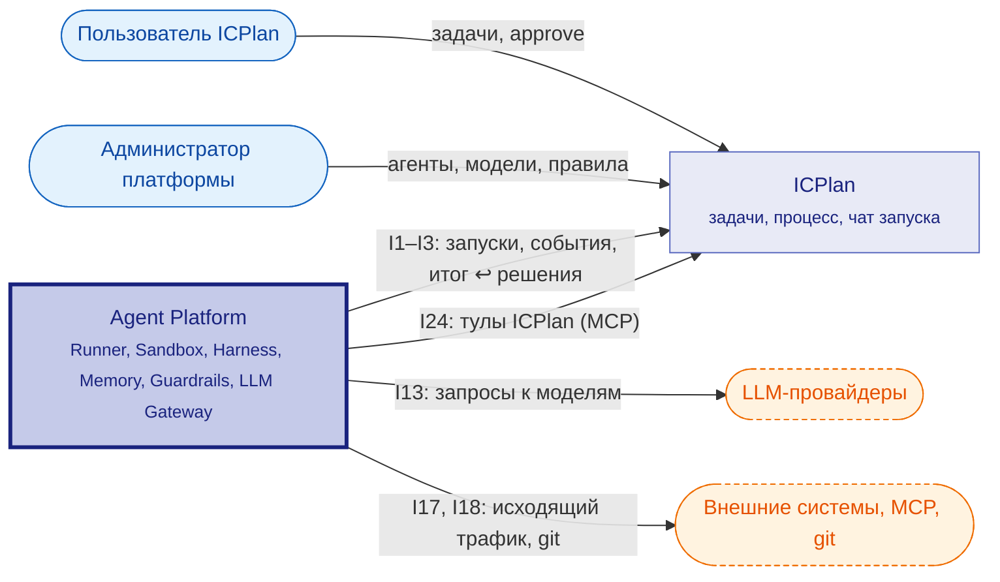
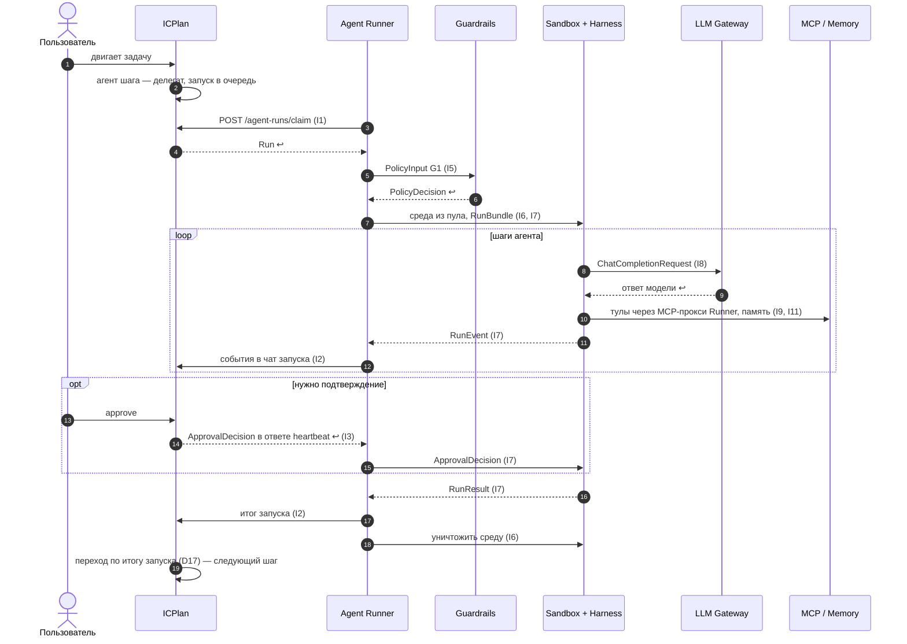
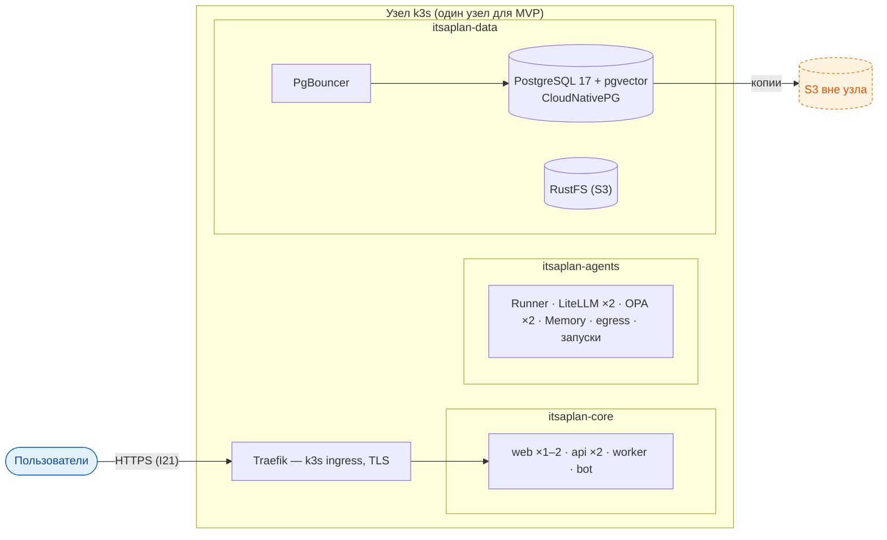

# Агентная архитектура (v0.9)

Модель C4: **C1** — наша система (Agent Platform) и её связь с ICPlan и внешним миром (ниже). **C2** — карта платформы выше: компоненты и связи между ними. Устройство каждого компонента (C3) — на его вкладке «Архитектура». Схемы — по [FORMAT.md](FORMAT.md).

## C1 — System Context

Интеграция с ICPlan: Agent Runner — внешний раннер ICPlan (забирает запуски, шлёт события и итог, получает решения пользователя в ответе heartbeat). Стыки каждого компонента — вкладка «Интеграции», типы данных и матрица интерфейсов — [Справка](docs/data-types.md).

## Взаимодействие компонентов {#interaction}

Сквозной поток MVP: пользователь двигает задачу — агент выполняет — итог возвращается в задачу. Правило оформления — [«Порядок работы и сценарии»](docs/rules/architecture-methodology.md#how); порядок работы каждого компонента — раздел «Как работает» на его вкладке «Архитектура».

### Порядок работы и сценарии

#### Порядок работы

| # | Шаг | Участники | Данные | I | Сценарий |
|---|---|---|---|---|---|
| 1 | Задача вошла в шаг процесса с агентом | ICPlan → ICPlan | `delegateUserId` задачи | — | С1 |
| 2 | Запуск в очередь | ICPlan → БД ICPlan | `Run` (pending) | — | С1 |
| 3 | Runner забирает запуск | Agent Runner → ICPlan | `Run` | I1 | С1 |
| 4 | Допуск и бюджет (G1) | Agent Runner → Guardrails | `PolicyInput` → `PolicyDecision` | I5 | С1 |
| 5 | Среда и задание | Agent Runner → Sandbox, Harness | `SandboxClaim`, `RunBundle` | I6, I7 | С1 |
| 6 | Вызов модели | Harness → LLM Gateway | `ChatCompletionRequest` | I8 | С1 |
| 7 | Действия и память | Harness → MCP-прокси Runner → MCP; Harness → Memory | `McpToolCall`, `M3Record` | I9, I11 | С1 |
| 8 | Шаги работы | Harness → Agent Runner → ICPlan | `RunEvent` | I7, I2 | С1 |
| 9 | Подтверждение | ICPlan → Agent Runner → Harness | `ApprovalDecision` | I3, I7 | С1 |
| 10 | Итог | Harness → Agent Runner → ICPlan | `RunResult` | I7, I2 | С1 |
| 11 | Уничтожение среды | Agent Runner → Sandbox | `sandboxId` | I6 | С1 |
| 12 | Переход задачи по итогу запуска — следующий шаг процесса (снова 1) | ICPlan → ICPlan | `process_step.on_success / on_failure` | — | С1 |

#### С1. Сквозной поток MVP

## Развёртывание (C4 deployment)

Ресурсы узла и профиль нагрузки — [R&D: профиль нагрузки](docs/rnd/load-profile.md), разделы «Нагрузка и производительность» спек. Подробно: спека [platform-infrastructure](openspec/changes/define-agent-platform/specs/platform-infrastructure/spec.md) и [схема](openspec/changes/define-agent-platform/specs/platform-infrastructure/architecture.md). Технологии — [сводная таблица](docs/TECHNOLOGIES.md). Обоснование: [Kubernetes](docs/rnd/kubernetes-runtime.md) · [ingress](docs/rnd/ingress-and-balancing.md) · [СУБД и хранилища](docs/rnd/data-stores.md) · [design D15, D16](openspec/changes/define-agent-platform/design.md).

## Сквозные решения

Что выбрано — одной фразой; почему и подробности — в решении (design) и на странице компонента ([правило](docs/rules/architecture-methodology.md)).

| Решение | Что выбрано | D | Подробно |
|---|---|---|---|
| Агентский цикл | Harness на LangGraph внутри sandbox: модель «думает», остальное — Harness | D2 | [Harness](components/harness/index.md) |
| Guardrails | четыре точки: G1, G2 видят смысл (OPA), G3, G4 не обойти; Rego в git, данные в Platform module | D6, D19 | [Guardrails](components/guardrails/index.md) |
| Очередь и планирование | очередь в ICPlan; Runner стартует запуск, когда свободны все слоты | D14 | [Agent Runner](components/agent-runner/index.md) |
| Исполнение | тёплый пул + одноразовый контейнер на запуск | D1 | [Sandbox](components/sandbox/index.md) |
| Память | уровни M0–M6, область видимости — атрибут записи; M3 — Memory API | D4, D20 | [Memory](components/memory/index.md) |
| RAG | не в MVP: документы — `get_document`, код — агентный поиск | D13 | [Memory](components/memory/index.md) |
| Хранение конфигурации | определения — БД ICPlan; наши настройки — Platform module; Rego — git; перенос — YAML | D9 | [Platform module](components/platform-module/index.md) |
| MCP или прямой вызов | правила R1–R7; агент ходит к MCP только через MCP-прокси Runner | D10, D19 | [MCP / Tools](components/mcp-tools/index.md) |
| Рабочие данные | `/workspace` исчезает со средой; код — ветка и PR; документы — в задачу | D11 | [Sandbox](components/sandbox/index.md) |
| Observability | события пишутся всегда в формате AG-UI, показываются в задаче чатом запуска | D12, D18, D21 | [Observability](components/observability/index.md) |
| Ход задачи | процесс задачи: шаг = колонка + агент, переход делает ICPlan по итогу | D17 | [ICPlan](components/icplan/index.md) |
