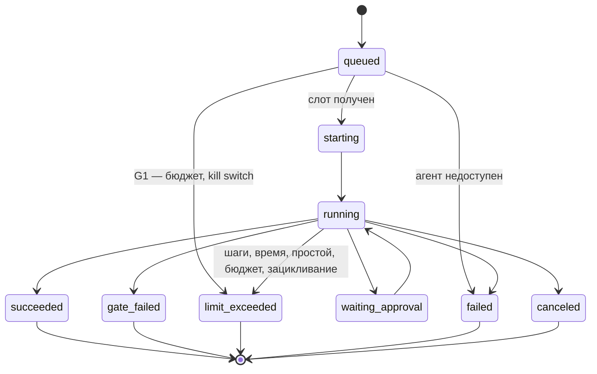

Порядок работы компонента: что за чем происходит внутри и с соседями (источник — `docs/how/agent-runner.md`, на сайте — вкладка «Архитектура» компонента). Поля данных — в контрактах на вкладке «Интеграции» компонента, таблицы — на вкладке «Данные», стороны и протоколы — в карточках «Интеграций», сквозной сценарий — в [архитектуре](../../architecture.md#interaction).

### Порядок работы и сценарии

#### Порядок работы

| # | Поток | Участники | Данные | I | Сценарий |
|---|---|---|---|---|---|
| 1 | Опрос очереди | Agent Runner → ICPlan | `Run` | I1 | С1 |
| 2 | Планирование: свободны ли слоты (глобальный, агента, модели, задачи) | Agent Runner → таблица слотов | `queued` → `admitted` | — | С1 |
| 3 | Допуск и бюджет (G1) | Agent Runner → Guardrails | `PolicyInput` → `PolicyDecision` | I5 | С1 |
| 4 | Определение и настройки версии запуска, после слотов; версия закрепляется в запуске (D23) | Agent Runner → Platform module | `AgentDefinition`, `AgentSettings` | I4 | С1 |
| 5 | Контейнер из тёплого пула | Agent Runner → Sandbox | `SandboxClaim` | I6 | С1 |
| 6 | Токен репозиториев на запуск | Agent Runner → git-провайдер | `RepoGrant` | I18 | — |
| 7 | Задание для Harness | Agent Runner → Harness | `RunBundle` | I7 | С1 |
| 8 | События шагов | Harness → Agent Runner → ICPlan | `RunEvent` | I7, I2 | С1 |
| 9 | Решение по паузе | ICPlan → Agent Runner → Harness | `ApprovalDecision` | I3, I7 | — |
| 10 | Итог | Harness → Agent Runner → ICPlan | `RunResult` | I7, I2 | С1 |
| 11 | Таймаут или отмена | Agent Runner → Harness | сигнал остановки | I7 | — |
| 12 | Уничтожение контейнера, долив пула | Agent Runner → Sandbox | `sandboxId` | I6 | С1 |

#### С1. Запуск от очереди до итога

```mermaid
sequenceDiagram
  autonumber
  participant IC as ICPlan
  participant R as Agent Runner
  participant G as Guardrails (OPA)
  participant PM as Platform module
  participant S as Sandbox
  participant H as Harness
  Note over R,IC: Bearer API-ключ агента
  R->>IC: POST /agent-runs/claim (I1)
  IC-->>R: Run ↩
  R->>R: слоты: queued → admitted
  R->>G: PolicyInput G1 (I5)
  G-->>R: PolicyDecision ↩
  alt отказ G1
    R->>IC: POST /agent-runs/:runId/result — failed (I2)
  else допущен
    Note over R,PM: сервисный токен; 404 — запуск не pending или агент не external
    R->>PM: GET /platform/runs/:runId/agent (I4, D23)
    PM-->>R: {version, definition: AgentDefinition, settings: AgentSettings} ↩
    R->>S: контейнер из пула — SandboxClaim (I6)
    R->>H: RunBundle (I7)
    loop шаги агента
      H-->>R: RunEvent (I7)
      R->>IC: POST /agent-runs/:runId/events (I2)
    end
    H-->>R: RunResult (I7)
    R->>IC: POST /agent-runs/:runId/result (I2)
    R->>S: уничтожить контейнер, долить пул (I6)
  end
```

### Состояния запуска


Единый список статусов запуска — требование R-RUN-07; остальные документы ссылаются на него.



| Причина завершения Harness (R-HRN-09) | Статус запуска (R-RUN-07) | Статус в ICPlan (`agent_run`) |
|---|---|---|
| `done` | `succeeded` | `success` |
| `gate_failed` | `gate_failed` | `failed` с пометкой «не прошёл проверку» |
| `limit` (шаги, время, простой, `loop_detected`) | `limit_exceeded` | `failed` с причиной |
| `error` | `failed` | `failed` |
| остановка пользователем | `canceled` | `canceled` |
