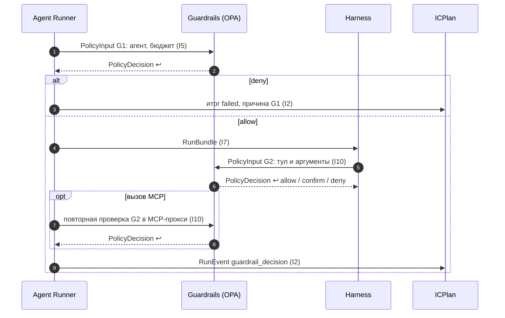

Порядок работы компонента: что за чем происходит внутри и с соседями (источник — `docs/how/guardrails.md`, на сайте — вкладка «Архитектура» компонента). Поля данных — в контрактах на вкладке «Интеграции» компонента, таблицы — на вкладке «Данные», стороны и протоколы — в карточках «Интеграций», сквозной сценарий — в [архитектуре](../../architecture.md#interaction).

### Порядок работы и сценарии

#### Порядок работы

| # | Поток | Точка | Участники | Данные | I | Сценарий |
|---|---|---|---|---|---|---|
| 1 | Правила (логика) | — | git → бандл OPA | Rego | — | — |
| 2 | Данные правил | — | Platform module → Guardrails | `OpaBundleData` | I16 | — |
| 3 | Включение точек | — | конфиг деплоя → сервисы | `gN.enabled` | — | — |
| 4 | Допуск запуска | G1 | Agent Runner → Guardrails | `PolicyInput` → `PolicyDecision` | I5 | С1 |
| 5 | Проверка действия; для MCP — повторно в Runner | G2 | Harness → Guardrails | `PolicyInput` → `PolicyDecision` | I10 | С1 |
| 6 | Изоляция | G3 | профиль → Sandbox | сеть, ФС, ресурсы | I6 | — |
| 7 | Проверка запроса к модели | G4 | хуки LLM Gateway | вход и ответ модели | I8 | — |
| 8 | Аудит решений | все | Agent Runner → ICPlan | `RunEvent` (`CUSTOM` `guardrail_decision`) | I2 | С1 |

#### С1. Допуск запуска (G1) и проверка действия (G2)

