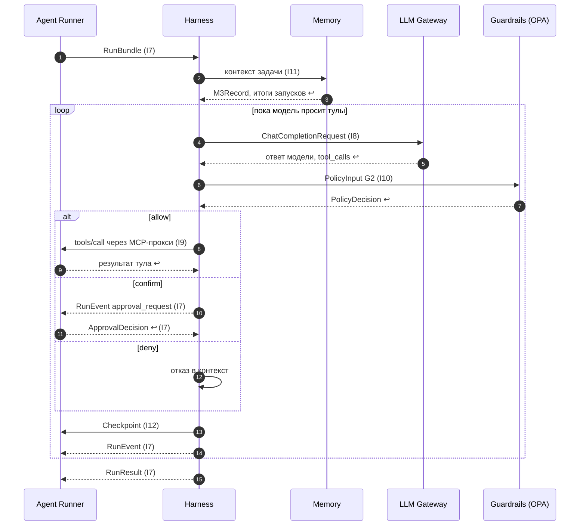
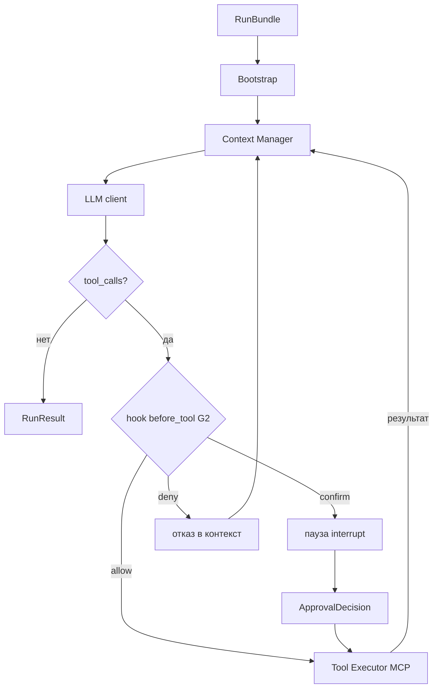
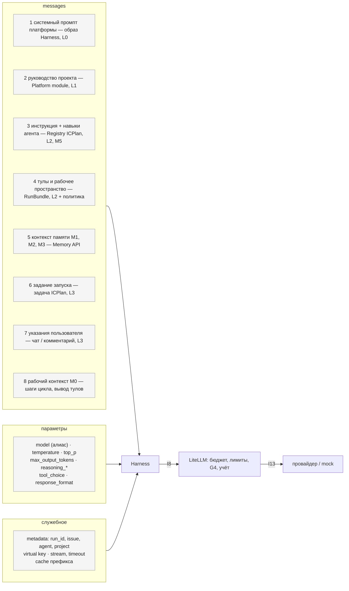

Порядок работы компонента: что за чем происходит внутри и с соседями (источник — `docs/how/harness.md`, на сайте — вкладка «Архитектура» компонента). Поля данных — в контрактах на вкладке «Интеграции» компонента, таблицы — на вкладке «Данные», стороны и протоколы — в карточках «Интеграций», сквозной сценарий — в [архитектуре](../../architecture.md#interaction).

### Порядок работы и сценарии

#### Порядок работы

| # | Поток | Участники | Данные | I | Сценарий |
|---|---|---|---|---|---|
| 1 | Задание | Agent Runner → Harness | `RunBundle` | I7 | С1 |
| 2 | Сборка контекста: инструкция, навыки, M3, M2 | Harness → Memory | `M3Record`, итоги запусков | I11 | С1 |
| 3 | Вызов модели | Harness → LLM Gateway | `ChatCompletionRequest` | I8 | С1 |
| 4 | Проверка действия (G2) | Harness → Guardrails | `PolicyInput` → `PolicyDecision` | I10 | С1 |
| 5 | Вызов тула | Harness → MCP-прокси Agent Runner → MCP-сервер | `McpToolCall` | I9 | С1 |
| 6 | Пауза на подтверждение | Harness → Agent Runner → ICPlan | `RunEvent` (`CUSTOM` `approval_request`) | I7, I2 | С1 |
| 7 | Сохранение шага | Harness → Agent Runner (checkpointer) | `Checkpoint` | I12 | С1 |
| 8 | Шаги работы | Harness → Agent Runner | `RunEvent` | I7 | С1 |
| 9 | Итог | Harness → Agent Runner | `RunResult` | I7 | С1 |

#### С1. Шаг цикла с вызовом тула



### Цикл




### Сборка запроса к модели {#llm-request}


Что уходит в модель на каждом шаге, откуда это берётся и кто это меняет. Требование — R-HRN «Сборка запроса к модели»; параметры — [таблица параметров Harness](../../openspec/changes/define-agent-platform/specs/agent-harness/interfaces.md).



### Слои промпта

| # | Слой | Тип данных | Откуда | Где хранится | Кто меняет | Когда меняется | В кэше префикса |
|---|---|---|---|---|---|---|---|
| 1 | Системный промпт платформы: правила безопасности, формат итога, работа с тулами и памятью | промпт | образ Harness | git платформы (S8), версия `prompt.platform_version` | разработчик платформы | новым образом Harness | да |
| 2 | Руководство проекта | промпт | Platform module | S2, `prompt.guidance` | администратор | со следующего запуска | да |
| 3 | Инструкция и навыки агента (M5) | промпт | Registry ICPlan | S1, версия определения агента | администратор | со следующего запуска | да |
| 4 | Описание тулов (схемы) и рабочего пространства | конфигурация | `RunBundle` (Runner), MCP `tools/list` | S1, политика доступа S2 | администратор | со следующего запуска | да |
| 5 | Контекст памяти: переписка M1, итоги M2, состояние M3 | контекст памяти | Memory API | S1, S4 | ICPlan, Runner, агент ([потоки памяти](../how/memory.md)) | каждый запуск | нет |
| 6 | Задание: задача, критерии приёмки, заметка возврата, итог прошлого шага | промпт | ICPlan (`Run`) | S1 | пользователь | каждый запуск | нет |
| 7 | Указания пользователя во время работы | промпт | ICPlan → Runner (heartbeat) | S1 (M1) | пользователь | во время запуска | нет |
| 8 | Рабочий контекст M0: ответы модели, вызовы и вывод тулов | ответы модели и тулов | Harness | только память запуска | Harness | каждый шаг | нет |

Порядок задаёт приоритет: нижний слой не отменяет правила слоя 1 (защита от prompt injection в задаче и выводе тулов).

### Параметры запроса

Откуда Harness берёт каждое поле запроса. Уровни, значения и границы параметров — в [interfaces.md спеки Harness](../../openspec/changes/define-agent-platform/specs/agent-harness/interfaces.md), поля запроса — в модели [`ChatCompletionRequest`](../../data-model.md#model-chatcompletionrequest).

| Поле запроса (OpenAI-совместимое) | Откуда берётся |
|---|---|
| `model` | `agent.model` (алиас) |
| `temperature`, `top_p` | `model.temperature`, `model.top_p` |
| `max_tokens` | `model.max_output_tokens` (не больше остатка `limits.max_tokens`) |
| `reasoning_effort` / `thinking.budget_tokens` | `model.reasoning_effort`, `model.reasoning_budget_tokens` |
| `tools`, `tool_choice`, `parallel_tool_calls` | набор тулов агента, `model.tool_choice`, `model.parallel_tool_calls` |
| `response_format` | `model.response_format` |
| `stream`, `timeout` | всегда `true`; `request.timeout_s` |
| `metadata` | `run_id`, `issue_key`, `agent` — атрибуция затрат (R-LLM-03) |
| ключ (`Authorization`) | virtual key агента |

Неподдерживаемые моделью параметры LiteLLM отбрасывает (`drop_params: true`); токены размышлений входят в бюджет запуска; текст размышлений не пишется в события, кроме `events.level: всё`.

### Пример

Запрос `ChatCompletionRequest` со слоями промпта (поля сверяются с моделью при сборке):

```json
{ "model": "team-default",
  "messages": [
    { "role": "system", "content": "<1 правила платформы v1.3>\n<2 руководство проекта>\n<3 инструкция агента v5 + навыки>" },
    { "role": "user", "content": "<6 задание MKT-42: описание, критерии приёмки, итог прошлого шага>\n<5 контекст: M3, итоги M2>" }
  ],
  "tools": [ { "type": "function", "function": { "name": "itsaplan_get_issue", "parameters": { "type": "object" } } } ],
  "tool_choice": "auto", "parallel_tool_calls": false,
  "temperature": 0.2, "max_tokens": 8192, "reasoning_effort": "medium",
  "stream": true,
  "metadata": { "run_id": 1042, "issue_key": "MKT-42", "agent": "analyst" } }
```
