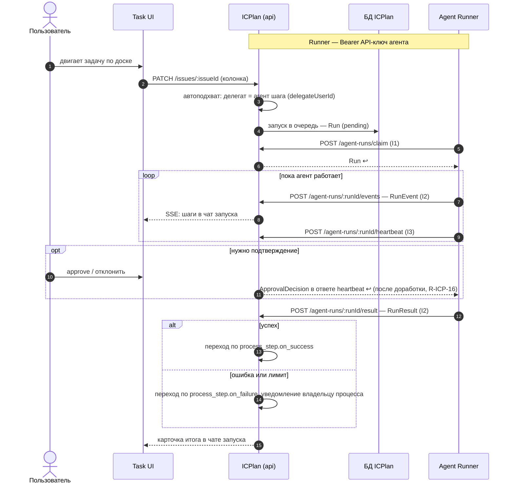

Порядок работы компонента: что за чем происходит внутри и с соседями (источник — `docs/how/icplan.md`, на сайте — вкладка «Архитектура» компонента). Поля данных — в контрактах на вкладке «Интеграции» компонента, таблицы — на вкладке «Данные», стороны и протоколы — в карточках «Интеграций», сквозной сценарий — в [архитектуре](../../architecture.md#interaction).

### Порядок работы

| # | Поток | От → к | Данные |
|---|---|---|---|
| 1 | Пользователь двигает задачу по доске | Пользователь → Task UI | смена статуса задачи |
| 2 | Автоподхват: шаг процесса / Действие → агент-делегат | ICPlan → ICPlan | `delegateUserId` задачи |
| 3 | Постановка запуска в очередь | ICPlan → БД | `Run` (pending) |
| 4 | Runner забирает запуск | Agent Runner → ICPlan | `Run` |
| 5 | Ход работы агента в чат задачи | Agent Runner → ICPlan → браузер (SSE) | `RunEvent` (события AG-UI) → [чат запуска](#agent-feed) |
| 6 | Подтверждение действия | Пользователь → Task UI → Runner | `ApprovalDecision` |
| 7 | Итог в задачу | Agent Runner → ICPlan | `RunResult` → карточка итога в чате запуска; комментарии агент пишет сам тулом |
| 8 | Переход задачи по итогу запуска (по процессу; агент колонку не меняет) | ICPlan → ICPlan | `process_step.on_success / on_failure` |
| 9 | Администратор настраивает агента | Админ → Control Plane UI → Registry | `AgentDefinition` |

### То же — sequence-диаграммой (пробный вид для сравнения)

Таблица выше и схема ниже описывают одно и то же; после выбора останется один вид ([FORMAT.md](../../FORMAT.md), «Sequence»).

Шаг 9 таблицы (администратор настраивает агента) — отдельный сценарий, в эту схему не входит.
