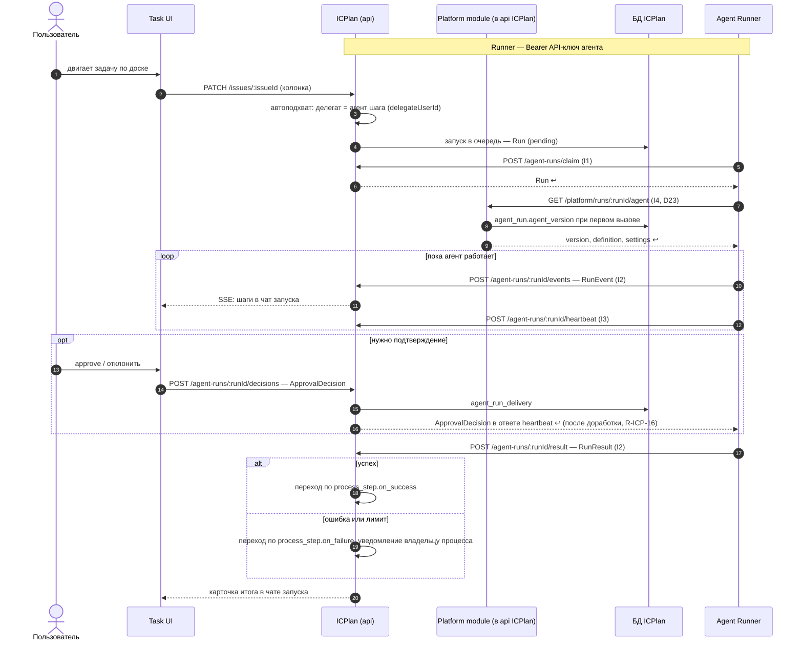

Порядок работы компонента: что за чем происходит внутри и с соседями (источник — `docs/how/icplan.md`, на сайте — вкладка «Архитектура» компонента). Поля данных — в контрактах на вкладке «Интеграции» компонента, таблицы — на вкладке «Данные», стороны и протоколы — в карточках «Интеграций», сквозной сценарий — в [архитектуре](../../architecture.md#interaction).

### Порядок работы и сценарии

#### Порядок работы

| # | Поток | Участники | Данные | I | Сценарий |
|---|---|---|---|---|---|
| 1 | Пользователь двигает задачу по доске | Пользователь → Task UI → ICPlan | колонка задачи | — | С1 |
| 2 | Автоподхват: агент шага становится делегатом | ICPlan → ICPlan | `delegateUserId` задачи | — | С1 |
| 3 | Запуск в очередь | ICPlan → БД ICPlan | `Run` (pending) | — | С1 |
| 4 | Runner забирает запуск | Agent Runner → ICPlan | `Run` | I1 | С1 |
| 4а | Runner берёт определение и настройки версии запуска (D23) | Agent Runner → Platform module (в api ICPlan) | `{version, definition: AgentDefinition, settings: AgentSettings}` | I4 | С1 |
| 5 | Ход работы агента в чат задачи | Agent Runner → ICPlan → Task UI | `RunEvent` → [чат запуска](#agent-feed) | I2 | С1 |
| 6 | Подтверждение действия | Пользователь → Task UI → ICPlan → Agent Runner (ответ heartbeat) | `ApprovalDecision` | I20, I3 | С1 |
| 7 | Итог в задачу | Agent Runner → ICPlan | `RunResult` | I2 | С1 |
| 8 | Переход задачи по итогу запуска | ICPlan → ICPlan | `process_step.on_success / on_failure` | — | С1 |
| 9 | Администратор настраивает агента | Администратор → Control Plane UI → ICPlan | `AgentDefinition` | I20 | — |
| 10 | Агент работает с задачей через MCP | MCP-прокси Agent Runner → MCP itsaplan-core | `McpToolCall` | I24 | — |

#### С1. Задача проходит шаг процесса

