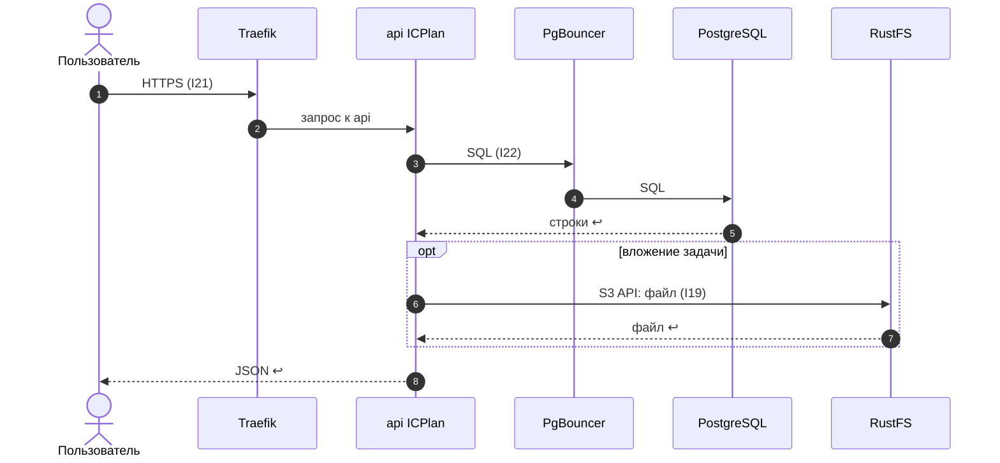
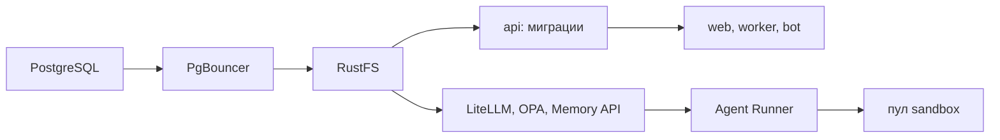

Порядок работы компонента: что за чем происходит внутри и с соседями (источник — `docs/how/infrastructure.md`, на сайте — вкладка «Архитектура» компонента). Поля данных — в контрактах на вкладке «Интеграции» компонента, таблицы — на вкладке «Данные», стороны и протоколы — в карточках «Интеграций», сквозной сценарий — в [архитектуре](../../architecture.md#interaction).

### Порядок работы и сценарии

#### Порядок работы

| # | Поток | Участники | Данные | I | Сценарий |
|---|---|---|---|---|---|
| 1 | Вход пользователя | Браузер → Traefik → `web` / `api` | HTML / JSON | I21 | С1 |
| 2 | MCP агентов | MCP-прокси Agent Runner → `api /mcp` | JSON-RPC | I24 | — |
| 3 | Запросы к БД | сервисы → PgBouncer → PostgreSQL | SQL | I22 | С1 |
| 4 | Вложения и артефакты | Agent Runner, ICPlan → RustFS | файлы | I19 | С1 |
| 5 | Резервные копии | CloudNativePG → S3 вне узла | базовые копии + WAL | — | — |
| 6 | Создание запусков (этап 4) | Agent Runner → Kubernetes API | манифест Pod | I23 | — |
| 7 | Развёртывание | Администратор → Helm → Kubernetes API | чарты, values, Secret | — | — |

#### С1. Запрос пользователя к ICPlan

### Порядок запуска

