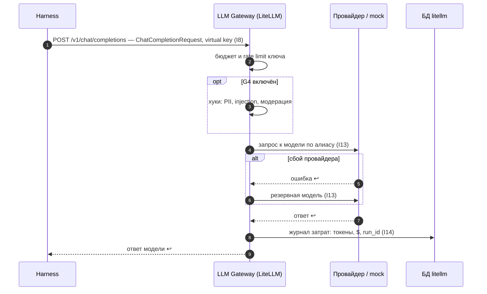

Порядок работы компонента: что за чем происходит внутри и с соседями (источник — `docs/how/llm-gateway.md`, на сайте — вкладка «Архитектура» компонента). Поля данных — в контрактах на вкладке «Интеграции» компонента, таблицы — на вкладке «Данные», стороны и протоколы — в карточках «Интеграций», сквозной сценарий — в [архитектуре](../../architecture.md#interaction).

### Порядок работы и сценарии

#### Порядок работы

| # | Поток | Участники | Данные | I | Сценарий |
|---|---|---|---|---|---|
| 1 | Запрос к модели по алиасу | Harness → LLM Gateway | `ChatCompletionRequest`, virtual key агента | I8 | С1 |
| 2 | Проверка бюджета и rate limit | LLM Gateway → LLM Gateway | ключ, лимиты | — | С1 |
| 3 | Проверки G4 | хуки LLM Gateway | вход и ответ | — | С1 |
| 4 | Маршрут к модели | LLM Gateway → провайдер / mock | запрос провайдера | I13 | С1 |
| 5 | Резервная модель при сбое | LLM Gateway → резервный провайдер | тот же запрос | I13 | С1 |
| 6 | Учёт затрат | LLM Gateway → БД `litellm` → Observability | токены, $, `run_id` | I14 | С1 |
| 7 | Выдача virtual key и бюджетов | Platform module → LLM Gateway | `VirtualKey` | I15 | — |

#### С1. Вызов модели

