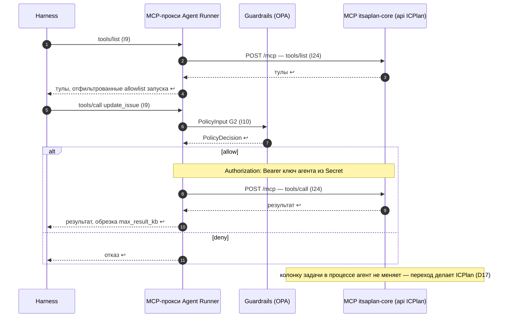

Порядок работы компонента: что за чем происходит внутри и с соседями (источник — `docs/how/mcp-tools.md`, на сайте — вкладка «Архитектура» компонента). Поля данных — в контрактах на вкладке «Интеграции» компонента, таблицы — на вкладке «Данные», стороны и протоколы — в карточках «Интеграций», сквозной сценарий — в [архитектуре](../../architecture.md#interaction).

### Порядок работы и сценарии

#### Порядок работы

| # | Поток | Участники | Данные | Правило | I | Сценарий |
|---|---|---|---|---|---|---|
| 1 | Список тулов агенту | MCP-сервер → MCP-прокси Agent Runner → Harness | тулы, отфильтрованные allowlist запуска (D19) | R3 | I9 | С1 |
| 2 | Вызов тула | Harness → MCP-прокси Agent Runner → MCP-сервер | `McpToolCall` | R2 | I9, I24 | С1 |
| 3 | Проверка перед вызовом | Harness, затем MCP-прокси → Guardrails | `PolicyInput` G2 | — | I10 | С1 |
| 4 | Работа с задачей | MCP itsaplan-core внутри api ICPlan | задача, комментарий, поля задачи | R3 | I24 | С1 |
| 5 | Работа с кодом | MCP git → git-провайдер | ветка, PR | R3 | — | — |
| 6 | Запись памяти | нативный тул Harness → Memory | `M3Record` | R4 | I11 | — |
| 7 | Внутренние вызовы платформы | сервис → сервис | REST, не MCP | R7 | — | — |

#### С1. Вызов тула itsaplan-core

