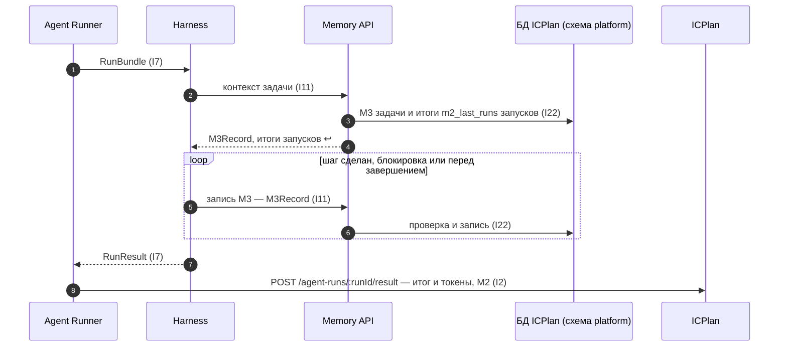

Порядок работы компонента: что за чем происходит внутри и с соседями (источник — `docs/how/memory.md`, на сайте — вкладка «Архитектура» компонента). Поля данных — в контрактах на вкладке «Интеграции» компонента, таблицы — на вкладке «Данные», стороны и протоколы — в карточках «Интеграций», сквозной сценарий — в [архитектуре](../../architecture.md#interaction).

### Порядок работы и сценарии

#### Порядок работы

Каждый уровень памяти **кто-то пишет** и **кто-то читает**. Агент сам пишет только M3 (и M4 после MVP); остальные уровни заполняют ICPlan, Runner, Harness и люди. Проверки до записи — [правила записи по уровням](../../openspec/changes/define-agent-platform/specs/agent-memory/interfaces.md#write-rules).

| # | Уровень | Направление | Кто → куда | Когда (триггер) | Что | Требование | I | Сценарий |
|---|---|---|---|---|---|---|---|---|
| 1 | M0 | запись | Harness → контекст запуска | каждый шаг цикла | сообщения модели, вывод тулов, итог сжатия | R-HRN-07 «Управление контекстом» | — | — |
| 2 | M0 | чтение | контекст → модель (LiteLLM) | каждый вызов модели | весь рабочий контекст | R-HRN-02 «Агентский цикл» | I8 | — |
| 3 | M0 | удаление | Runner → sandbox | конец запуска | контекст уничтожается вместе со средой | R-MEM-01 «Уровни памяти» | I6 | — |
| 4 | M1 | запись | ICPlan → БД (сообщения чата, комментарии) | каждое сообщение пользователя или агента | текст, автор, время (с маской секретов) | R-MEM-03 «Автоматическая запись M1 и M2» | — | — |
| 5 | M1 | чтение | Memory → Harness (`RunBundle`); ICPlan → чат агента | старт запуска; ответ в чате (последние 20 сообщений) | переписка по задаче / треду | R-MEM-05 «История запусков в контексте» | I11 | — |
| 6 | M2 | запись | Runner → ICPlan → `agent_run` | конец запуска | статус, итог, токены, время | R-MEM-03, R-ICP-04 | I2 | С1 |
| 7 | M2 | запись | ICPlan (вердикт пользователя) → `agent_run` | «принято / не выполнено» | вердикт и заметка | R-AP-19 «Вердикт по результату» | — | — |
| 8 | M2 | чтение | Memory → Harness | старт запуска | итоги последних `m2_last_runs` запусков задачи и заметки возврата | R-MEM-05 | I11 | С1 |
| 9 | M2 | чтение | Observability → сводка | по запросу | агрегаты запусков | R-OBS-13 | I20 | — |
| 10 | M3 | запись | агент → тул памяти → Memory API → БД | шаг сделан, найдена блокировка, перед завершением | `M3Record`: сделано, дальше, блокировки | R-MEM-04 «Состояние задачи M3», «Проверки записи в память» | I11 | С1 |
| 11 | M3 | чтение | Memory → Harness | старт запуска по задаче | последнее состояние задачи | R-MEM-04 | I11 | С1 |
| 12 | M4 | запись / чтение | агент → тул фактов / поиск | после MVP | факты с источником | R-MEM-06 (бэклог) | — | — |
| 13 | M5 | запись | администратор → Registry (ICPlan) | создание или изменение агента | инструкция, навыки (версия) | R-REG-02 «Определение агента» | I20 | — |
| 14 | M5 | чтение | Registry → Harness | сборка агента на старте | инструкция и навыки версии запуска | R-HRN-01 «Инициализация из определения агента» | I1, I7 | — |
| 15 | M6 | запись | пользователи → документы проекта ICPlan | работа людей с документами | документы проекта | базовое поведение ICPlan | — | — |
| 16 | M6 | чтение | агент → `get_document` (MCP ICPlan) | агенту нужен документ | текст документа (запись агенту запрещена) | R-MEM-01, R-MCP-13 | I9, I24 | — |
| 17 | M1–M3 | удаление | Memory → БД | по расписанию | записи старше срока хранения | R-MEM-08 «Срок хранения» | I22 | — |
| 18 | любые | удаление / исправление | администратор → Memory API | ошибочная память | запись удалена или новая версия | R-MEM-07 «Управление памятью» | — | — |

**Передача между шагами (D20).** M3 шага — его передача следующему: `artifacts` (ссылки, а не содержимое), `questions`, `criteriaNext` (предложенные критерии; попадают в чек-лист задачи с пометкой автора и подтверждаются по `criteria_approval` шага). Следующему шагу **не** передаются рабочий контекст M0, промпты и вывод тулов — они остаются в событиях запуска.

#### С1. Запуск по задаче: память на входе и выходе

