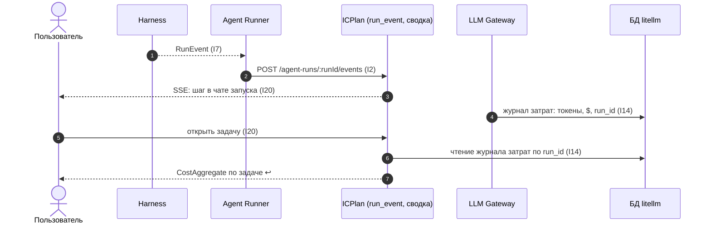

Порядок работы компонента: что за чем происходит внутри и с соседями (источник — `docs/how/observability.md`, на сайте — вкладка «Архитектура» компонента). Поля данных — в контрактах на вкладке «Интеграции» компонента, таблицы — на вкладке «Данные», стороны и протоколы — в карточках «Интеграций», сквозной сценарий — в [архитектуре](../../architecture.md#interaction).

### Порядок работы и сценарии

#### Порядок работы

| # | Поток | Участники | Данные | I | Сценарий |
|---|---|---|---|---|---|
| 1 | Шаги запуска | Harness → Agent Runner → ICPlan (БД) | `RunEvent` | I7, I2 | С1 |
| 2 | Решения guardrails | Agent Runner, Harness → ICPlan (БД) | `RunEvent` (`CUSTOM` `guardrail_decision`) | I2 | — |
| 3 | Затраты | LLM Gateway → журнал затрат → агрегаты | токены, $, `run_id` | I14 | С1 |
| 4 | Чат запуска в задаче | БД и живой поток → панель «Агент» | `RunEvent` (AG-UI), [поток](../stories/icplan.md#agent-feed) | I20 | С1 |
| 5 | Затраты задачи | агрегаты → Task UI | `CostAggregate` | I20 | С1 |
| 6 | Очистка по сроку | БД | события старше срока; агрегаты остаются | — | — |

#### С1. Шаг агента и затраты в задаче

