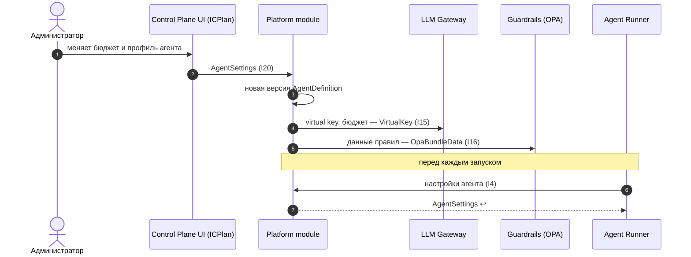

Порядок работы компонента: что за чем происходит внутри и с соседями (источник — `docs/how/platform-module.md`, на сайте — вкладка «Архитектура» компонента). Поля данных — в контрактах на вкладке «Интеграции» компонента, таблицы — на вкладке «Данные», стороны и протоколы — в карточках «Интеграций», сквозной сценарий — в [архитектуре](../../architecture.md#interaction).

### Порядок работы и сценарии

#### Порядок работы

| # | Поток | Участники | Данные | I | Сценарий |
|---|---|---|---|---|---|
| 1 | Администратор меняет настройки агента | Control Plane UI → Platform module | `AgentSettings` | I20 | С1 |
| 2 | Новая версия определения агента | Platform module → БД | `AgentDefinition` + версия | — | С1 |
| 3 | Runner читает профиль и бюджет перед запуском | Agent Runner → Platform module | `AgentSettings` | I4 | С1 |
| 4 | Алиасы и бюджеты в LLM Gateway | Platform module → LLM Gateway | `VirtualKey` | I15 | С1 |
| 5 | Данные правил для OPA | Platform module → Guardrails | `OpaBundleData` | I16 | С1 |
| 6 | Экспорт / импорт агента | Администратор ↔ Platform module | YAML `AgentDefinition` | I20 | — |

#### С1. Настройки агента: от администратора до запуска

