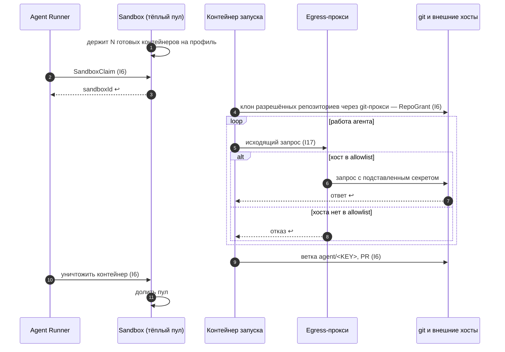

Порядок работы компонента: что за чем происходит внутри и с соседями (источник — `docs/how/sandbox.md`, на сайте — вкладка «Архитектура» компонента). Поля данных — в контрактах на вкладке «Интеграции» компонента, таблицы — на вкладке «Данные», стороны и протоколы — в карточках «Интеграций», сквозной сценарий — в [архитектуре](../../architecture.md#interaction).

### Порядок работы и сценарии

#### Порядок работы

| # | Поток | Участники | Данные | I | Сценарий |
|---|---|---|---|---|---|
| 1 | Пул держит N готовых контейнеров на профиль | Sandbox → Docker | профиль | — | С1 |
| 2 | Runner забирает контейнер | Agent Runner → Sandbox (пул) | `SandboxClaim` | I6 | С1 |
| 3 | Клон разрешённых репозиториев в `/workspace` | контейнер → git (credential helper, git-прокси) | `RepoGrant` | I6 | С1 |
| 4 | Весь исходящий трафик | контейнер → egress-прокси → allowlist | HTTP(S) | I17 | С1 |
| 5 | Подстановка секретов | egress-прокси → внешний API | заголовки авторизации | I17 | — |
| 6 | Код наружу | контейнер → git | ветка `agent/<KEY>`, PR | I6 | С1 |
| 7 | Уничтожение и долив пула | Agent Runner → Sandbox | `sandboxId` | I6 | С1 |
| 8 | Шаг подготовки (D19): кэш по хешу lock-файлов или установка | Agent Runner → контейнер подготовки → `setup.registries` | `setup.script`, `/workspace/.deps` | I6 | — |
| 9 | Доустановка во время работы | Harness → тул `install_dependencies` → Agent Runner | lock-файлы | — | — |
| 10 | Вызовы MCP (из sandbox напрямую — нет) | Harness → MCP-прокси Agent Runner | `McpToolCall` | I9 | — |

#### С1. Жизнь контейнера запуска

