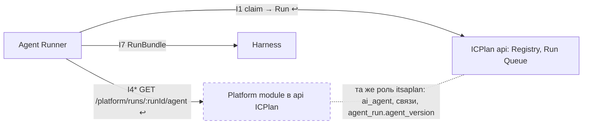

# R&D: Откуда Agent Runner берёт определение агента

← [Все R&D](README.md) · [методология R&D v3.1](../rules/rnd-methodology.md) · компонент: **Agent Runner, ICPlan (Registry), Platform module** · решение: [design D23](../../openspec/changes/define-agent-platform/design.md) · замечание: [Z-ICP-3](../reviews/findings/icplan.md)

<div class="rnd-hero" markdown>
<div class="rnd-q">Вопрос</div>
Чтобы собрать задание Harness (`RunBundle.agent`), Runner нужны модель, инструкция, навыки, тулы, MCP и версия агента. `POST /agent-runs/claim` форка отдаёт только запуск (`prompt`, `systemPrompt`), наши настройки (I4) — без модели, навыков и MCP. Откуда Runner берёт определение агента и какой версии?

<div class="rnd-a">Ответ: у Platform module одним вызовом `GET /platform/runs/:runId/agent` (I4, сервисный токен): определение `agent/v1` и настройки одной версии. Platform module работает внутри api ICPlan и читает таблицы Registry сам. Версия запуска закрепляется в `agent_run.agent_version` при первом вызове. Claim форка не меняется.</div>

<span class="rnd-badge adopt">Adopt</span> определение через API Platform module · 0 $ · данные 12.10.2026
</div>

```deck
# Покрытие потребностей П1–П6
> только вариант через Platform module закрывает версию и снимок одной версии без правки claim
stack C. API Platform module: 4 ok, 2 part, 0 no
stack A. Снимок в ответе claim: 2 ok, 3 part, 1 no
stack B. Эндпоинт ICPlan по ключу агента: 2 ok, 3 part, 1 no
stack 0. Как сейчас (claim + I4): 3 ok, 1 part, 2 no
# Объём доработки
> выбранный вариант — одна подзадача минимального Platform module на этапе 2; claim форка не меняется
bar Определение через Platform module: 6/6 2.3.7 — 6 ч (I4, сервисный токен, версия запуска) ok
# Позиции ролей
side API Platform module | Снимок в claim
pos Архитектор: -2 | версией и снимком уже владеет Platform module
pos Разработчик Runner (оппонент): 1 | один ответ claim; согласен, если I4 отдаёт всё одним ответом
pos Сопровождающий форка: -2 | модуль `runner` форка не трогаем
pos Безопасность: -1 | только по своему запуску, без секретов
pos DevOps: -1 | сервисный токен уже есть; модуль нужен в 2.3
# Что меняется
> D23; новый эндпоинт I4; Platform module частично переезжает в задачу 2.3
stack Документы: 12 ok, 0 part, 0 mute
```

<div class="rnd-grid" markdown>
<div class="take" markdown>
**Берём**

- один вызов Platform module при старте запуска: `{version, definition: AgentDefinition, settings: AgentSettings}`;
- формат `agent/v1` экспорта (R-REG-04) — один сериализатор для экспорта и запуска;
- закрепление версии в `agent_run.agent_version` (R-REG-03): повторная выдача запуска получает ту же версию.
</div>
<div class="adapt" markdown>
**Адаптируем**

- I4: к настройкам (`/platform/agents/:agentId/settings`) добавляется определение версии запуска (`/platform/runs/:runId/agent`);
- слоты планировщика по-прежнему из текущих настроек, определение — при старте после слотов (R-CP-03);
- минимальный Platform module (этот эндпоинт и сервисный токен) — в задаче 2.3, а не 4.4.
</div>
<div class="drop" markdown>
**Не берём**

- снимок определения в ответе claim — правка модуля `runner` форка, версия закрепляется раньше старта;
- отдельный эндпоинт определения в форке по ключу агента — второй вызов и вторая версия рядом с I4.
</div>
</div>

<div class="rnd-grid" markdown>
<div class="no" markdown>
**Отсеяны до сравнения**

- чтение БД `itsaplan.public` Runner'ом — против D22 и R-CP-02;
- существующий `GET /teams/:teamId/ai-agents/:agentId` (и MCP-тул `get_ai_agent`) — отдаёт счётчики навыков и тулов, без списков и версии;
- определения в YAML у Runner — второй источник правды, против D9.
</div>
<div class="risk" markdown>
**Риски и пересмотр**

- Platform module нужен уже на этапе 2 (задача 2.3), а не только на этапе 4;
- MCP-серверов агента в форке нет (только `mcp_enabled` команды и проекта для MCP самого ICPlan): источник в определении — `project_resource` (`mcp`) и `access_policy` Platform module, подтвердить в 2.3;
- пересмотр — если Platform module вынесут из api ICPlan в свой сервис: тогда он читает Registry через API ICPlan.
</div>
</div>

## Э1. Вопрос {#e1}

**Ситуация.** Runner работает как внешний раннер ICPlan (D8): забирает запуск ключом агента (`POST /agent-runs/claim`, I1) и собирает задание Harness `RunBundle`. В нём `agent: {agentId, model, version, instructions, skills[]}` и `mcp[]` (`datamodel.MODELS`). Определение агента по R-REG-02 — модель, инструкция, навыки, тулы, MCP, проекты, версия. Хранится в БД ICPlan (D9, D18 «граница Registry и Platform module»). Наши настройки (бюджеты, профили, автономия) — Platform module (I4).

**Осложнение.** Claim форка отдаёт только `id`, `trigger`, `prompt`, `systemPrompt`, `attempts`, `issueId`, `issueIdentifier` (`apps/api/src/modules/agents/runner/model.ts`, форк). Модели, навыков, тулов, MCP и версии в ответе нет. Описание I1 в `agent-registry/interfaces.md` говорит «определение и версию Runner берёт по нему (I4)», но модель `AgentSettings` (I4) определения не содержит.

**Вопрос.** Через какой стык Runner получает определение агента и как закрепляется версия запуска?

**Решает:** архитектор с разработчиком Runner и сопровождающим форка. **Не решаем:** состав полей определения (R-REG-02), где хранятся версии (D9, R-CP-04), доставку содержимого навыков в среду (задача 2.3).

<span class="gate">G1</span> ✅ вопрос — выбор стыка; связь с Z-ICP-3, R-REG-02, R-REG-03, задачей 2.3.

## Э2. Потребности {#e2}

| # | Потребность | Источник | Без неё |
|---|---|---|---|
| П1 | Runner получает модель, инструкцию, навыки, тулы, MCP агента | R-REG-02, `RunBundle.agent`, задача 2.3 | Harness не собрать |
| П2 | версия запуска: указанная задачей — она, несуществующая — отказ; иначе актуальная на старт (запуск в `queued` стартует с новыми настройками); повторная выдача — та же версия | R-REG-03, R-CP-03, `agent_run.agent_version`, `GET /runs/:runId/checkpoint` | продолжение после сбоя идёт по другой инструкции |
| П3 | определение и наши настройки — одной версии | `AgentSettings.version` — «единая версия агента», снимок `agent_settings_version.data` | запуск собран из определения одной версии и настроек другой |
| П4 | только через API, без доступа к таблицам | R-CP-02, D22 | Runner видит чужие таблицы |
| П5 | Runner получает только своё и без секретов | `runner-auth.ts` форка («runner can only ever reach its own work»), R-CP-05, Т5 | утечка определений и ключей |
| П6 | минимум правок кода форка вне наших модулей | D18 «слияние с upstream», risks design | конфликты при обновлении форка |

<span class="gate">G2</span> ✅ у каждой потребности есть источник и цена отсутствия.

## Э3. Опорное решение: как сейчас {#e3}

| Функция | Что делает | Потребность | Факт |
|---|---|---|---|
| claim отдаёт `prompt` и `systemPrompt` | инструкция агента уже в `systemPrompt` разделом `## Instructions` | П1 частично | `runner/service.ts`, `buildSystemPrompt` (Б, код) |
| claim не отдаёт модель, навыки, тулы, MCP, версию | — | П1, П2 не закрыты | `runner/model.ts`, `RunnerRunResponse` (Б, код) |
| I4 `GET /platform/agents/:agentId/settings` | автономия, бюджет, профили, `toolsAllow`, планирование, `version` | П3 частично | `datamodel.MODELS` `AgentSettings`; [API Platform module](../api/platform-module.md) |
| у внешнего агента поля модели пусты | `model`, `tools` — «NULL/empty for an external agent» | П1 | `packages/db/src/schema/app.ts`, `ai_agent` (Б, код) |
| карточка внешнего агента без модели, навыков, тулов | стек разделов внешнего агента: основное, проекты, ключ, доступ, триггеры, раннер | П1 | `TeamAiAgentFields.tsx` (Б, код) |

**Вывод этапа.** Сейчас Runner получает только инструкцию (внутри `systemPrompt`) и наши настройки. Модели, навыков, MCP и версии нет — ==П1 и П2 опорное решение не закрывает==.

<span class="gate">G3</span> ✅ функции связаны с потребностями, наличие подтверждено кодом.

## Э4. Альтернативы и их ключевые функции {#e4}

Поиск — по коду форка (`apps/api/src/modules/agents`), решениям design (D3, D9, D18, D22) и спекам (agent-registry, control-plane, agent-runner), 12.10.2026.

| Вариант | Ключевая функция | Источник |
|---|---|---|
| 0. Как сейчас | claim + I4 настроек | код форка, `datamodel` |
| A. Снимок в ответе claim | `Run.agent` — определение в ответе `POST /agent-runs/claim`, доработка форка | `runner/service.ts` |
| B. Эндпоинт ICPlan по ключу агента | `GET` определения в модуле агентов форка под `runnerAuth` | `runner-auth.ts` |
| C. API Platform module | `GET /platform/runs/:runId/agent` — определение и настройки версии запуска; Platform module в api ICPlan читает Registry сам | D3, D22, `agent_settings_version` |
| D. Чтение БД | Runner читает `ai_agent` и связи SQL-запросом | — |
| E. API форка как есть | `GET /teams/:teamId/ai-agents/:agentId` и MCP-тул `get_ai_agent` с ключом агента | `core/index.ts`, `core/model.ts` |
| F. YAML у Runner | определения из файлов конфигурации Runner | задача 2.3 («из YAML до появления Platform module») |

<span class="gate">G4</span> ✅ 7 кандидатов; «как сейчас» и «сделать самим» (A, B, C) в списке; три вида источников — код, решения, спеки и задачи.

## Э5. Ценность функций {#e5}

| Функция | Потребность | Почему ценна | Доказательство | Класс |
|---|---|---|---|---|
| полное определение (модель, навыки, MCP) | П1 | без него нет `RunBundle` | R-REG-02, `RunBundle` | базовая |
| доступ только через API | П4 | граница прав по схеме | D22, R-CP-02 | базовая |
| закрепление версии на старте и при повторе | П2 | продолжение с checkpoint по той же инструкции | R-REG-03, R-CP-03 | линейная |
| определение и настройки одним ответом одной версии | П3 | нет сборки из двух версий | `AgentSettings.version` — единая (`datamodel`) | линейная |
| правка только наших модулей | П6 | меньше конфликтов слияния | D18 | линейная |
| счётчики навыков и тулов вместо списков (E) | — | не закрывает П1 | `AiAgentResponse.skillCount`, `toolCount` (Б, код) | безразличная |
| второй источник определения (F) | — | расходится с UI | D9 | обратная |

<span class="gate">G5</span> ✅ ценность берущихся функций подтверждена кодом и решениями (Б).

## Э6. Перенос и критерии {#e6}

| Функция | Решение | Причина |
|---|---|---|
| полное определение | брать | MUST по П1 |
| доступ только через API | брать | MUST по П4 |
| формат `agent/v1` экспорта | брать | уже описан (`AgentDefinition`); один сериализатор |
| закрепление версии в `agent_run.agent_version` | адаптировать | колонка уже запланирована (`FORK_COLUMNS`); пишет Platform module при первом вызове |
| слоты — из текущих настроек | оставить | планировщику версия не нужна (D14) |
| второй источник определения | не брать | D9 |

**MUST:** П1, П4. **Критерии сравнения:** П2 (версия), П3 (одна версия), П5 (своё и без секретов), П6 (правки форка). Цепочка: потребность → функция Э5 → класс → критерий.

<span class="gate">G6</span> ✅ у каждой функции решение и причина; критерии из линейных функций.

## Э7. Отсев и встраивание {#e7}

| Кандидат | MUST П1 | MUST П4 | Итог |
|---|---|---|---|
| 0. Как сейчас | нет | да | остаётся опорой для сравнения |
| D. Чтение БД | да | нет: у роли `runner` только `REFERENCES` на `agent_run` (`DB_GRANTS`) | отсеян |
| E. API форка как есть | нет: счётчики вместо списков, версии нет | да | отсеян |
| F. YAML у Runner | частично | да | отсеян: два источника правды (D9) |

| Кандидат | I-коды | Вызовы | Данные | Изменения у соседей | Готовность |
|---|---|---|---|---|---|
| A. Снимок в claim | I1 (меняется) | Runner → ICPlan, pull не меняется | модуль `runner` форка читает `ai_agent`, связи и `platform.agent_settings_version` | ICPlan: `RunnerRunResponse`, SQL claim; Platform module: отдаёт снимок модулю форка | И2: claim работает в форке, расширение описано |
| B. Эндпоинт ICPlan по ключу | I1 (новый эндпоинт рядом), I4 | Runner → ICPlan, Runner → Platform module | модуль агентов форка читает Registry; версия — у Platform module | ICPlan: новый маршрут под `runnerAuth` | И2 |
| C. API Platform module | I4 (расширяется) | Runner → Platform module, как сейчас | Platform module читает `public.ai_agent`, `agent_skill_link`, `agent_tool_link` той же ролью `itsaplan` (D22), снимок `agent_settings_version`, пишет `agent_run.agent_version` | Registry: колонка `agent_version` (запланирована); claim не меняется | И2: стык I4 описан, кода Platform module нет |



**Вывод этапа.** A меняет код модуля `runner` форка и заставляет его читать схему `platform`. B добавляет второй вызов и вторую версию рядом с I4. ==C встаёт в уже описанный стык I4== и меняет только наш модуль.

<span class="gate">G7</span> ✅ у прошедших кандидатов есть строка встраивания по I1, I4, I7; изменения у соседей названы.

## Э8. Спор ролей {#e8}

Роли 🤖. Оппонент — разработчик Runner, он защищает A («всё в одном ответе claim»). «Адвокат дьявола» атакует C.

| Роль | За | Довод | Опасение | Согласится, если |
|---|---|---|---|---|
| Архитектор 🤖 | C | версией и снимком уже владеет Platform module (`agent_settings_version`) | — | — |
| Сопровождающий форка 🤖 | C | модуль `runner` форка не меняется (D18) | — | — |
| Безопасность 🤖 | C | секретов в `agent/v1` нет (R-CP-05) | сервисный токен читает определение любого агента | вызов только по запуску в `pending` внешнего агента |
| DevOps 🤖 | C | сервисный токен I4 уже есть | Platform module нужен раньше этапа 4 | минимальный модуль — в 2.3 |
| Разработчик Runner 🤖 (оппонент) | A | один запрос на запуск | два вызова: claim и I4 | определение и настройки — одним ответом I4 |

| Спор | Разрешение |
|---|---|
| Оппонент: «claim — и так единственный вызов на запуск» | **условие:** I4 вызывается и сейчас (настройки); C не добавляет вызовов, а расширяет ответ I4. При A версия закрепляется при claim, и запуск, ждущий слота, стартует со старыми настройками — нарушение R-CP-03 |
| Безопасность: «токен Runner читает чужих агентов» | **условие:** эндпоинт по `runId`: только запуск в `pending` агента `kind = external`; иначе 404 |
| Адвокат дьявола: «Platform module появляется в 4.4, а определение нужно в 2.3» | **задача:** эндпоинт `GET /platform/runs/:runId/agent` и сервисный токен — в 2.3; настройки до 4.4 — значения по умолчанию и YAML, как уже записано в 2.3 |
| Адвокат дьявола: «у внешнего агента в форке модель и тулы пусты, а карточка их не показывает» | **задача:** поля Registry для внешнего агента в карточке — [R&D экранов Platform module](platform-module-screens.md) |

<span class="gate">G8</span> ✅ у каждого спора есть разрешение.

## Э9. Выбор {#e9}

| Потребность | 0. Как сейчас | A. Снимок в claim | B. Эндпоинт ICPlan по ключу | C. API Platform module |
|---|---|---|---|---|
| П1 определение | не закрывает: только инструкция | с доработкой: расширить `RunnerRunResponse` | с доработкой: новый маршрут | с доработкой: сборка из таблиц Registry |
| П2 версия | не закрывает | частично: закрепляется при claim, до слотов (R-CP-03) | частично: версия у Platform module, эндпоинт её читает | закрывает: при первом вызове на старте, повтор — та же |
| П3 одна версия | частично: только настройки | частично: модуль форка читает `platform` | не закрывает: два ответа | закрывает: один ответ |
| П4 только API | закрывает | закрывает | закрывает | закрывает |
| П5 своё, без секретов | закрывает | закрывает: ключ агента | закрывает: ключ агента | с доработкой: проверка запуска по `runId` |
| П6 правки форка | закрывает | не закрывает: модуль `runner` и SQL claim | частично: новый маршрут в модуле агентов | закрывает: только Platform module |

- **Утверждение.** Runner берёт определение у Platform module: `GET /platform/runs/:runId/agent` → `{version, definition, settings}` (D23).
- **Основания.** Platform module уже ведёт единую версию и снимок (`AgentSettings.version`, `agent_settings_version`). Он работает внутри api ICPlan той же ролью и читает таблицы Registry (D3, D22). Runner уже вызывает I4 сервисным токеном.
- **Связка.** Один владелец версии отдаёт определение и настройки одной версии одним ответом, а код форка вне нашего модуля не меняется.
- **Оговорка.** Пока Platform module — модуль api ICPlan.
- **Когда неверно.** Если Platform module вынесут в отдельный сервис (риск D22), чтение Registry пойдёт через API ICPlan. Если upstream добавит определение в claim, вариант A станет бесплатным.

<span class="gate">G9</span> ✅ вывод следует из покрытия и спора; есть условие пересмотра.

## Э10. Последствия {#e10}

Изменения вносит основной агент по [процессу изменений](../rules/change-process.md).

| Изменение | Документ | Статус |
|---|---|---|
| Решение D23: определение агента для запуска — `GET /platform/runs/:runId/agent`, версия в `agent_run.agent_version`, claim не меняется | [design](../../openspec/changes/define-agent-platform/design.md) | ✅ внесено |
| Эндпоинт `GET /platform/runs/:runId/agent` → `{version, definition: AgentDefinition, settings: AgentSettings}`; ошибки 404 (запуск не `pending` или агент не `external`), 409 (версии нет, R-REG-03) | `datamodel.ENDPOINT_IO`; [API Platform module](../api/platform-module.md), раздел «Для Runner и журнал» | ✅ внесено |
| I4: модели `AgentSettings`, `AgentDefinition`, `WorkspaceSource`; описание «настройки, определение версии запуска, манифест» | `datamodel.INTEG` I4 | ✅ внесено |
| I1: «определение и версию Runner берёт по нему (I4)» → «по `runId` у Platform module (I4, D23)» | `agent-registry/interfaces.md` | ✅ внесено |
| Строка I4: формат `{version, definition, settings}` | `agent-runner/interfaces.md`, `control-plane/interfaces.md` | ✅ внесено |
| `agent_run.agent_version`: задаёт задача (R-REG-03) или Platform module при первом вызове | `datamodel.FORK_COLUMNS` | ✅ внесено |
| Операция Registry «определение агента для запуска — способ выбирается в R&D (Z-ICP-3)» → D23 | `html-view/subcomponents.py`, Registry | ✅ внесено |
| Последовательность запуска: шаг I4 возвращает определение и настройки, вызов — после слотов | [поток Agent Runner](../how/agent-runner.md) | ✅ внесено |
| Задача 2.3: подзадача 2.3.1 — ответ D23; минимальный Platform module (эндпоинт, сервисный токен) в 2.3 | [задача 2.3](../tasks/2.3-config-from-icplan.md) | ✅ внесено |
| Расхождение: R-CP-01 относит алиас модели к Platform module, D18 и R-REG-02 — к Registry; предлагается Registry (`ai_agent.model` = алиас LiteLLM у внешнего агента) | [spec control-plane](../../openspec/changes/define-agent-platform/specs/control-plane/spec.md) R-CP-01 | ✅ внесено |
| Источник MCP-серверов агента в определении — `project_resource` (`mcp`) и `access_policy` | `datamodel.py`, задача 2.3 | ✅ внесено |
| Z-ICP-3 → решено D23 | [замечания ICPlan](../reviews/findings/icplan.md) | ✅ внесено |

<span class="gate">G10</span> ✅ у каждого изменения есть документ и статус.

## Источники

Чтение — 12.10.2026; в скобках уровень доказательства.

- Код форка `D:\АИ агент\itsaplan` (А, прочитан): `apps/api/src/modules/agents/runner/model.ts`, `runner/service.ts`, `runner-auth.ts`, `core/index.ts`, `core/model.ts`; `packages/db/src/schema/app.ts` (`ai_agent`, `agent_skill_link`, `agent_tool_link`, `agent_run`); `apps/web/src/features/teams/components/ai-agents/TeamAiAgentFields.tsx`
- [design](../../openspec/changes/define-agent-platform/design.md): D3, D8, D9, D14, D18, D22
- Спеки: [agent-registry](../../openspec/changes/define-agent-platform/specs/agent-registry/spec.md) R-REG-02, R-REG-03; [control-plane](../../openspec/changes/define-agent-platform/specs/control-plane/spec.md) R-CP-01–R-CP-03; `interfaces.md` agent-registry, agent-runner
- `html-view/datamodel.py`: `INTEG` I1, I4, I7; `MODELS` `Run`, `AgentDefinition`, `AgentSettings`, `RunBundle`; `FORK_COLUMNS`; `DB_GRANTS`
- [R&D: хранение конфигурации](config-storage.md) — D9
