# Путь изменения документа агентом

← [Правила документации](README.md) · [процесс изменения](change-process.md) · [работа с документами](doc-work.md#tools)

## История

**Как** владелец продукта, **я хочу**, чтобы агент проводил любое изменение документации по одному и тому же пути — с правилом нужного документа в момент правки, автоматическими проверками и записью причины каждого расхождения, — **чтобы** документы не расходились между собой, а ошибка, найденная однажды, не повторялась.

## Весь путь

```mermaid
flowchart TD
  classDef tool fill:#e8eaf6,stroke:#3f51b5,color:#1a237e
  classDef check fill:#e8f5e9,stroke:#2e7d32,color:#1b5e20
  classDef stop fill:#ffebee,stroke:#c62828,color:#b71c1c
  classDef human fill:#fff3e0,stroke:#ef6c00,color:#e65100

  A([Запрос владельца продукта]):::human --> B[Какие документы затронуты]
  B --> C["doctool route &lt;файл&gt;<br/>тип, правила, источник, методология"]:::tool
  C --> D{Файл генерируется?}
  D -- да --> E["правка источника<br/>(stories.py, datamodel.py, ROADMAP…)"]
  D -- нет --> F{Факт уже живёт<br/>в другом месте?}
  E --> F
  F -- да --> G[ссылка вместо копии]
  F -- нет --> H{Решение, выбор<br/>технологии?}
  G --> H
  H -- да --> I["R&D по методологии<br/>doctool rnd · навык doc-rnd"]:::tool
  I --> J["design: D-номер<br/>последствия Э10 по всей цепочке"]
  H -- нет --> K[Правка документа]
  J --> K
  K --> L["хук до правки: генерируемое? → стоп<br/>хук после правки: выжимка + проверки"]:::check
  L --> M["doctool check<br/>проверки сборки + tooling_check"]:::check
  M --> N{Замечания?}
  N -- да --> O["журнал отклонений:<br/>что → почему → правило → проверка"]:::stop
  O --> K
  N -- нет --> P{Модели, интеграции,<br/>имена?}
  P -- да --> Q["двое независимых читателей<br/>навык doc-dual-read"]:::tool
  Q --> R{Объяснения<br/>совпали?}
  R -- нет --> O
  R -- да --> S
  P -- нет --> S{Менялись правила<br/>или методология?}
  S -- да --> T["сначала инструменты: doctool, хуки,<br/>навыки, AGENTS.md; потом документы"]:::tool
  T --> U
  S -- нет --> U["Синхронизация по матрице:<br/>спеки, задачи, API, данные, R&D"]
  U --> V["python html-view/build.py<br/>трассировка, ссылки, якоря"]:::check
  V --> W["openspec validate --strict"]:::check
  W --> X["git commit → pre-commit:<br/>doctool staged"]:::check
  X --> Y[push → GitHub Pages]
  Y --> Z([Отчёт: что изменено, где, что найдено]):::human
```

## Шаги, инструменты и проверки

| # | Шаг | Инструмент | Проверка | Если не прошло |
|---|---|---|---|---|
| 1 | Понять, какие документы затронуты, и их тип | `doctool route <файл>` (выжимка из [типов документов](doc-types.md) и [работы с документами](doc-work.md)) | тип найден, методология указана | нет правил для пути → новый тип документа: строка в таблице типов |
| 2 | Генерируемый файл? | `doctool generated <файл>`; хук до правки (Claude) | правка генерируемого запрещена | правка источника, затем пересборка |
| 3 | Один факт — один источник | [таблица источников](change-process.md#single-source) | значения параметров — только в `interfaces.md`; данные — в `datamodel.py` | ссылка вместо копии |
| 4 | Решение или выбор | `doctool rnd`, навык `doc-rnd`, [методология R&D](rnd-methodology.md) | структура R&D v3 (сборка) | — |
| 5 | Правка | инструмент Edit; длинные правки — скриптом в файле, не через heredoc с обратными слешами | — | — |
| 6 | Правило в момент правки | хук после правки (Claude) или `doctool post <файл>` | выжимка правил + замечания | исправить сразу |
| 7 | Быстрые проверки | `doctool check` (доли секунды) | трассировка, интеграции, модели = OpenAPI форка, примеры, политика таблиц, потоки, `tooling_check` | расхождение → [журнал отклонений](deviations.md) с причиной, правило и проверка |
| 8 | Понятность моделей и имён | навык `doc-dual-read`, [правило](dual-read.md) | объяснения двух читателей совпали по смыслу | исправить в источнике, повторить |
| 9 | Правила или методология менялись | [изменение правил](change-process.md#rules-change) | `route` показывает новое правило; `tooling_check` чист | сначала инструменты, затем документы |
| 10 | Синхронизация связанных | [матрица](change-process.md) | — | — |
| 11 | Полная сборка | `python html-view/build.py` | замечаний 0, битых ссылок и якорей 0 | исправить |
| 12 | Спеки | `openspec validate <change> --strict` | valid | исправить |
| 13 | Коммит | `git commit` → хук `pre-commit` (`doctool staged`) | замечаний нет, генерируемое не правлено руками | коммит остановлен |
| 14 | Публикация | `git push` → GitHub Pages | сайт открывается | — |
| 15 | Отчёт | ответ владельцу | что изменено, где (файл и раздел), что найдено и почему | — |

## Что работает само, а что — по дисциплине агента

| Автоматически | По дисциплине |
|---|---|
| git-хук перед коммитом — для любого агента и человека | `doctool route` перед правкой |
| проверки сборки и `doctool check` | поиск источника факта |
| хуки Claude до и после правки — **если сессия открыта в папке репозитория** | двое читателей для моделей и имён |
| значения параметров на страницах блоков — из спек | запись причины в журнал отклонений |

## Критерии приёмки

- [ ] Для каждого изменённого файла агент назвал его тип и правило.
- [ ] Генерируемые файлы не правились руками.
- [ ] `doctool check`, сборка и `openspec validate` прошли без замечаний.
- [ ] Каждое найденное расхождение — строка в журнале отклонений с причиной и правилом.
- [ ] В отчёте — что изменено, где и что найдено.
