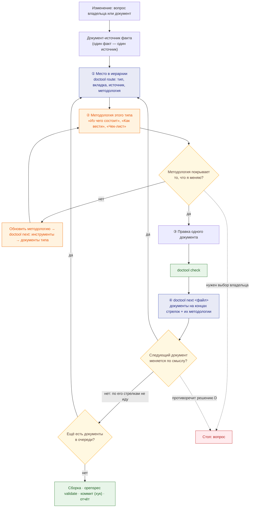

# Путь изменения документа агентом

← [Правила документации](README.md) · [граф связности](doc-graph.md) · [типы документов и вкладки](doc-types.md) · [процесс изменения](change-process.md)

## История

**Как** владелец продукта, **я хочу**, чтобы агент менял документацию **по одному документу за раз**: брал методологию именно этого документа, при необходимости сначала обновлял её, правил документ, а затем по графу связности переходил к следующему документу и делал с ним то же самое, **чтобы** изменения не расходились между документами и каждое было сделано по своему правилу, а не массовой правкой.

## Принцип

Изменение — это **цепочка документов**, а не пачка правок. В каждый момент агент работает с одним документом:

1. определяет, где этот документ в иерархии и по какой методологии он ведётся;
2. сверяет методологию с тем, что меняет; если она отстала — сначала обновляет её (а за ней инструменты);
3. правит документ и проверяет;
4. по графу связности находит следующие документы — и берёт **следующий один**.

## ① Где документ в иерархии

| Что узнаю | Откуда | Инструмент |
|---|---|---|
| Тип документа и вкладка | [типы документов](doc-types.md), колонка «Где»; [вкладки](doc-types.md#tabs) — на какой вопрос отвечает и чего на ней быть не должно | `doctool route <файл>` |
| Генерируется ли и что его источник | список генерируемых файлов | `doctool generated <файл>` (хук не даст править генерируемое) |
| Слой и узел графа | [граф связности](doc-graph.md): правила → запрос → решение → архитектура → спека → вкладки → работа → сводки | `doctool next <файл>` (первая строка — узел) |
| Где живёт факт | [один факт — один источник](change-process.md#single-source) | — |

Цепочка начинается с **самого верхнего документа, который меняется по смыслу**. Если вопрос — про значение, это `interfaces.md` спеки, а не задача или Deploy.

## ② Методология документа

Читаю методологию **только этого типа** — ссылку даёт `route`. «Справку» целиком не читаю.

Методологию обновляю **до правки документа**, если:

- она молчит о том, что я меняю (раздел, связь, вид данных);
- она ссылается на то, чего уже нет (вкладку, страницу, файл);
- документ правильный, а методология требует другого (значит, отстала она).

У методологии своя цепочка (`doctool next docs/rules/<методология>.md`): сначала **инструменты** (проверки doctool, навыки, хуки), затем **документы этого типа** — привести к новой методологии. Порядок — [изменение правил](change-process.md#rules-change).

## ③ Правка и проверка

Правлю один документ. После правки хук редактора сам показывает выжимку правил и следующие документы. `doctool check` за секунды проверяет трассировку, I-коды, модели, пути и соответствие инструментов правилам.

## ④ Следующий документ

`doctool next <файл>` выдаёт документы на концах стрелок графа: что в каждом проверить и по какой методологии он ведётся. Беру их **по одному** и повторяю цикл. Если следующий документ по смыслу не меняется (например, задача, объём которой не изменился), его стрелки дальше не прохожу — на этой ветке цепочка закончилась.

## Где останавливаюсь

| Ситуация | Что делаю |
|---|---|
| Очередь пуста, проверки и сборка чистые | цепочка закрыта → коммит и отчёт: какие документы изменены, в каком порядке, какие методологии обновлены |
| Нужен выбор продукта; изменение противоречит принятому решению D; удаление; новая вкладка | **стоп, вопрос владельцу**; ниже по цепочке ничего не меняю до ответа |
| Факт неизвестен | не придумываю: код форка, OpenAPI, design; нет — открытый вопрос в спеке |
| Документ выше по иерархии противоречит изменению | цепочка начинается с него |
| Расхождение вне цепочки | не правлю молча: строка в журнале отклонений или в таблице расхождений |

## Пример: «срок хранения M3 — 90 дней после закрытия задачи»

| # | Документ | Методология | Актуальна? | Правка | `next` дал |
|---|---|---|---|---|---|
| 0 | вопрос про значение → источник: `retention` в `interfaces.md` спеки Memory | — | — | проверка вверх: design D4 и R&D памяти срок M3 не задают → решение не меняется, вопрос владельцу не нужен | — |
| 1 | `agent-memory/interfaces.md`, `retention` | [SDD](sdd-methodology.md), [критерии спеки](spec-criteria.md) | да | значение и обоснование | Интеграции и Данные, Как работает, Deploy, задачи |
| 2 | `control-plane/interfaces.md`, `memory.retention` | та же | да | то же значение (параметр настраивается в Platform module) | те же узлы — уже в очереди |
| 3 | `datamodel.py`, `TABLE_POLICY["memory_m3"]` | [данные](data-methodology.md) | да | срок и очистка | Как работает, задачи |
| 4 | `docs/how/memory.md` | [архитектура](architecture-methodology.md) | да | срок в шагах не упоминается → не меняется, дальше не иду | — |
| 5 | `docs/techspec/memory.md` | [Deploy](tech-spec.md) | да | значение в примере конфигурации | — |
| 6 | задача 2.5 | [задачи](task-methodology.md) | да | подзадача очистки после закрытия задачи — если её нет | ROADMAP, TASKS, tasks.md |
| 7 | ROADMAP и сводки | [задачи](task-methodology.md) | да | итоги, если изменилась оценка | — |
| — | конец | | | сборка, validate, коммит | |

Если бы срок M3 был зафиксирован в решении D, цепочка начиналась бы с design и останавливалась на вопросе владельцу до любой правки ниже.

## Инструменты, которые ведут по этому пути

| Что | Где |
|---|---|
| Место и методология документа | `./tools/doc route <файл>` |
| Следующие документы и их методологии | `./tools/doc next <файл>`; граф и пути узлов — `html-view/docgraph.py` |
| Подсказка после каждой правки | хук редактора (`doctool hook-post`): выжимка + следующие документы + замечания проверок |
| Запрет правки генерируемого | хук до правки (`doctool hook-pre`) |
| Сценарий для любого агента | навык `.claude/skills/doc-edit/SKILL.md`, `AGENTS.md` в корне репозитория |
| Проверки | `./tools/doc check`; перед коммитом — git-хук `pre-commit` |
| Инструменты соответствуют правилам | `tooling_check`: методологии существуют, `route` узнаёт типы, у узлов графа есть файлы |
