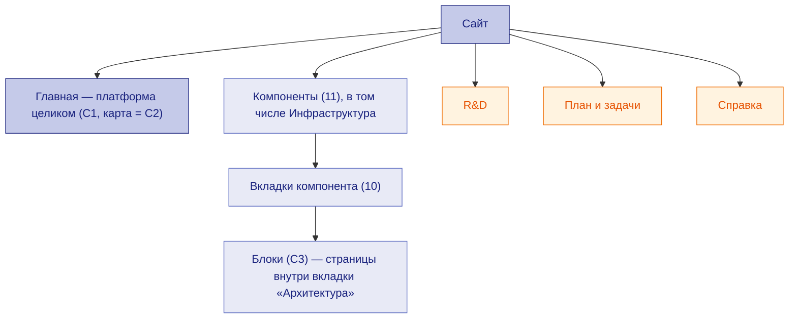

# Методология структуры документации

← [Правила документации](README.md) · [типы документов и вкладки](doc-types.md#tabs) · [путь изменения документа](agent-workflow.md)

Как устроена документация целиком: какие уровни, где лежат компоненты, какие вкладки у компонента, какие общие разделы и **из чего формируется каждая страница**. Что именно пишется на вкладке и чего на ней быть не должно — в [таблице вкладок](doc-types.md#tabs); здесь — иерархия и источники.

## Назначение и читатель

Отвечает на вопрос **«где лежит документ, откуда он берётся и по какой методологии ведётся»**. Читатель — тот, кто добавляет компонент, вкладку или раздел, и агент, который определяет место документа в иерархии ([путь изменения](agent-workflow.md)).

## Уровни

| Уровень | Что это | Правило |
|---|---|---|
| Главная | платформа целиком: C1, карта (C2), взаимодействие компонентов, развёртывание, сквозные решения | только то, что не принадлежит одному компоненту ([методология архитектуры](architecture-methodology.md)) |
| Компонент | единица ответственности (C2), у каждого — **один и тот же набор вкладок** | [тип сущности](architecture-methodology.md#entity) |
| Встроенный компонент | компонент внутри хоста (`components.HOST`) — **такие же вкладки**, как у компонента | [связность](architecture-methodology.md#connectivity) |
| Инфраструктура | **компонент**, а не отдельный раздел: кластер, вход, хранилища, бэкапы; на её «Данных» — базы данных платформы | как у компонента |
| Блок | часть компонента (C3), страница внутри вкладки «Архитектура», без своих вкладок | [методология блоков](block-methodology.md) |
| Общие разделы | R&D, План и задачи, Справка — сквозные списки и правила | ниже |

## Вкладки компонента и откуда они формируются

| Вкладка | Страница | Формируется из | Генерируется | Методология |
|---|---|---|---|---|
| Архитектура | `components/<к>/` | `components.py` (BLOCKS, ABOUT, HOST), `rationale.py`, `docs/how/<к>.md`, `subcomponents.py` (блоки) | да | [архитектура](architecture-methodology.md), [блоки](block-methodology.md) |
| User Stories | `docs/stories/<к>.md` | `stories.py`, `stories_extra/<к>.md` | да | [User Stories](us-methodology.md) |
| Спеки | `specs-by-component/<к>/` → `openspec/changes/*/specs/*/` | `components.py` (список спек), `spec.md`, `interfaces.md`, RTM, вопросы, подтверждения | список — да, спеки — нет | [SDD](sdd-methodology.md), [критерии](spec-criteria.md) |
| Задачи | `tasks-by-component/<к>/` → `docs/tasks/` | `components.py` (tids), `docs/tasks/*.md` | список — да | [задачи](task-methodology.md) |
| Интеграции | `docs/api/<к>.md` | `datamodel.py` (C1, карточки, контракты), `docs/api/<к>.md` (эндпоинты), OpenAPI форка | частично | [API](api-methodology.md), [данные](data-methodology.md) |
| Данные | `data-by-component/<к>/` | `datamodel.py` (таблицы, политика, `DATABASES`), схема форка | да | [данные](data-methodology.md) |
| Deploy | `docs/techspec/<к>.md` | файл + «Конфигурация» из `interfaces.md` | частично | [Deploy](tech-spec.md) |
| R&D | `rnd-by-component/<к>/` → `docs/rnd/` | `rationale.REFS` | список — да | [R&D](rnd-methodology.md) |
| Замечания | `docs/reviews/findings/<к>.md` | проверка ролями, реестр подтверждений | нет | [ревью](review-methodology.md#findings) |
| Справка | `docs/rules/` | общая для всех | нет | эта методология |

## Общие разделы и откуда формируется каждая страница

**R&D**

| Страница | Формируется из | Методология |
|---|---|---|
| Все R&D | `docs/rnd/README.md` — реестр, ведётся руками при новом R&D | [R&D](rnd-methodology.md) |
| R&D по компонентам | `rationale.REFS` | [R&D](rnd-methodology.md) |
| Последствия R&D | раздел Э10 каждого R&D (генерируется) | [R&D](rnd-methodology.md#consequences) |
| Решения (OpenSpec) | `openspec/changes/*/design.md`, `proposal.md` | [решения](decision-methodology.md) |

**План и задачи**

| Страница | Формируется из | Методология |
|---|---|---|
| Подтверждения документов | реестр `docs/approvals.md` (генерируется), список «Замечаний» | [подтверждения](approval-methodology.md) |
| Roadmap | `docs/ROADMAP.md` — этапы и задачи | [задачи и план](task-methodology.md) |
| Сводная таблица задач | `docs/TASKS.md` — по компонентам: сделано → нужно | [задачи и план](task-methodology.md) |
| Задачи по компонентам | `components.py` (tids) | [задачи и план](task-methodology.md) |
| Бэклог | `docs/BACKLOG.md` | [задачи и план](task-methodology.md) |
| Технологии | `docs/TECHNOLOGIES.md` | [сопровождающие](support-docs-methodology.md) |
| План документации | `docs/PLAN.md` | [сопровождающие](support-docs-methodology.md) |
| Задачи изменений (OpenSpec) | `tasks.md` изменений — генерируется из Roadmap | [задачи и план](task-methodology.md) |
| Ревью | `docs/reviews/*.md` | [ревью](review-methodology.md) |

**Справка** — только общее для всех: правила, [путь изменения](agent-workflow.md), [формат схем](../../FORMAT.md), термины и коды (генерируются из `integrations.GLOSSARY`), [типы данных](../data-types.md), персоны (из `stories.py`), методологии.

## Как вести

| Когда | Шаги |
|---|---|
| Новый компонент | все 10 вкладок сразу: строка в `components.py`, `docs/how`, `docs/techspec`, `docs/api`, истории, спека, задачи, R&D; проверка `connectivity_check` |
| Новая вкладка компонента | решение владельца → строка в таблице вкладок здесь и в [doc-types](doc-types.md#tabs) → `pagebar.TYPES` и навигация → у всех компонентов |
| Новая страница общего раздела | строка в таблице раздела здесь (источник и методология) → навигация в `build.py` |
| Изменилось место или источник страницы | сначала эта методология, затем инструменты ([изменение правил](change-process.md#rules-change)) |

## Чек-лист

- [ ] У каждого компонента, в том числе встроенного и Инфраструктуры, все вкладки.
- [ ] У каждой страницы общего раздела назван источник и методология.
- [ ] Блок — не вкладка, а страница внутри «Архитектуры».

## Проверки в сборке

`tooling_check`: вкладки `pagebar.TYPES` = таблица «Вкладки компонента»; `connectivity_check`: полный набор документов компонента.

## Связанные документы

[Типы документов и вкладки](doc-types.md) · [Путь изменения документа](agent-workflow.md) · [Методология архитектуры](architecture-methodology.md)
