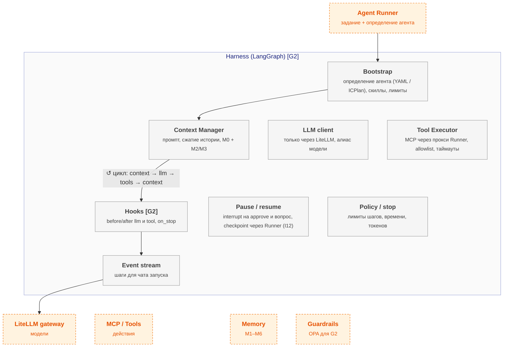

# agent-harness — схема

← [spec.md](spec.md)

Схема C3 по [FORMAT.md](../../../../../FORMAT.md). Цвет: зелёный — есть, жёлтый — частично, серый — не начато; оранжевый пунктир — соседний компонент.

## Схема

## Блоки

| Блок | Задача | Статус |
|---|---|---|
| Bootstrap | определение агента (YAML / ICPlan), скиллы, лимиты | ⬜ не начато |
| Context Manager | промпт, сжатие истории, M0 + M2/M3 | ⬜ не начато |
| LLM client | только через LiteLLM, алиас модели | ⬜ не начато |
| Tool Executor | MCP через прокси Runner, allowlist, таймауты | ⬜ не начато |
| Hooks | before/after llm и tool, on_stop | ⬜ не начато |
| Pause / resume | interrupt на approve и вопрос, checkpoint через Runner (I12) | ⬜ не начато |
| Policy / stop | лимиты шагов, времени, токенов | ⬜ не начато |
| Event stream | шаги для чата запуска | ⬜ не начато |

## Настройка

Параметры модуля — [interfaces.md](interfaces.md) (раздел «Параметры модуля»); на сайте — вкладка «Deploy» компонента, раздел «Конфигурация».

## Плюсы / минусы

| ➕ | ➖ |
|---|---|
| Approve и возобновление без своего механизма | Частые изменения API LangChain — версия закреплена (1.2.14), LangGraph за своим интерфейсом. |
| Долгие задачи переживают падение процесса | Пересмотр: прототип 1.3.9 покажет, что OpenAI Agents SDK проходит AG1–AG5 не хуже при меньшем коде. |
| Шаги агента видны в задаче по мере работы |  |

Обоснование: [R&D](../../../../../docs/rnd/harness-framework.md).
