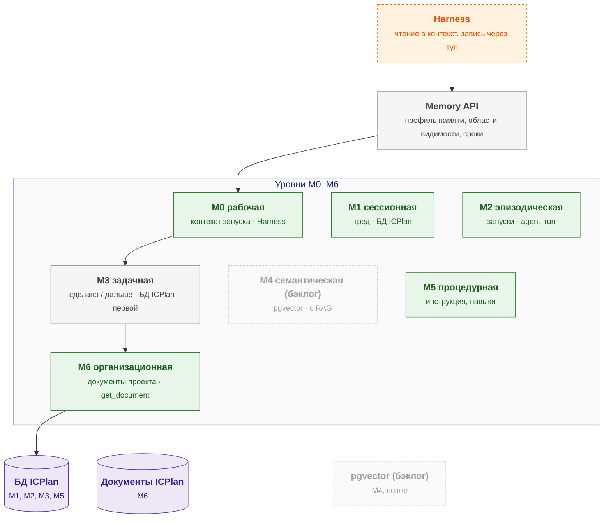

# agent-memory — схема

← [spec.md](spec.md)

Схема C3 по [FORMAT.md](../../../../../FORMAT.md). Цвет: зелёный — есть, жёлтый — частично, серый — не начато; оранжевый пунктир — соседний компонент.

## Схема

## Блоки

| Блок | Задача | Статус |
|---|---|---|
| Memory API | профиль памяти, области видимости, сроки | ⬜ не начато |
| M0 рабочая | контекст запуска · Harness | ✅ есть |
| M1 сессионная | тред · БД ICPlan | ✅ есть |
| M2 эпизодическая | запуски · agent_run | ✅ есть |
| M3 задачная | сделано / дальше · БД ICPlan · первой | ⬜ не начато |
| M4 семантическая | pgvector · с RAG | бэклог |
| M5 процедурная | инструкция, навыки | ✅ есть |
| M6 организационная | документы проекта · get_document | ✅ есть |
| БД ICPlan | M1, M2, M3, M5 | ✅ есть |
| Документы ICPlan | M6 | ✅ есть |
| pgvector | M4, позже | бэклог |

## Расширения и настройка

| Что настраивается | На что влияет |
|---|---|
| `read` | Полнота контекста против токенов |
| `write` | Преемственность между этапами |
| `m2_last_runs` | Память истории против токенов |
| `retention` | Объём хранилища, актуальность |
| `scope` | Кто видит память |

## Плюсы / минусы

| ➕ | ➖ |
|---|---|
| Следующий агент продолжает работу, а не начинает заново | Агент не пишет M3 — проверки записи R-MEM-15, напоминание перед завершением. |
| Меньше токенов: в контекст попадает нужное, а не вся история | Пересмотр: для M4 — выбор между Mem0 и LangMem на прототипе после MVP. |
| Агент учится на прошлых запусках (M2) |  |

Обоснование: [R&D](../../../../../docs/rnd/memory-model.md).
