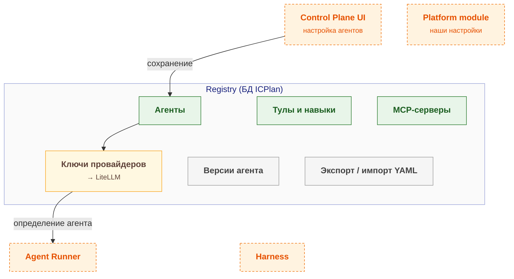

# agent-registry — схема

← [spec.md](spec.md)

Схема C3 по [FORMAT.md](../../../../../FORMAT.md). Цвет: зелёный — есть, жёлтый — частично, серый — не начато; оранжевый пунктир — соседний компонент.

## Схема

## Блоки

| Блок | Задача | Статус |
|---|---|---|
| Агенты | — | ✅ есть |
| Тулы и навыки | — | ✅ есть |
| MCP-серверы | — | ✅ есть |
| Ключи провайдеров | → LiteLLM | ⚠️ частично |
| Версии агента | — | ⬜ не начато |
| Экспорт / импорт YAML | — | ⬜ не начато |

## Расширения и настройка

| Что настраивается | На что влияет |
|---|---|
| `Статусы доски` | Какие этапы проходит задача |
| `Агент шага процесса` | Задача сама уходит нужному агенту |
| `Процесс типа задачи` | Разные типы — разные процессы |
| `Действия` | Автоматизация по меткам и полям |
| `Модель агента` | Качество и цена ответов |
| `Инструкция агента` | Что и как делает агент |
| `Тулы и навыки` | Набор доступных действий |
| `MCP проекта` | Без него агент не меняет задачи |

## Плюсы / минусы

| ➕ | ➖ |
|---|---|
| Не пишем трекер и UI с нуля — экономия месяцев разработки | Небольшое сообщество (925★): держим свой форк, доработки — модулями. |
| Процесс (статусы, переходы) настраивает сам пользователь, без кода | Пересмотр, если релизов It's a Plan нет больше 6 месяцев или агенты Plane выйдут в Community Edition с внешним исполнителем. |
| Агенты видны как участники команды: исполнитель, комментарии, история |  |

Обоснование: [R&D](../../../../../docs/rnd/tracker-choice.md).
