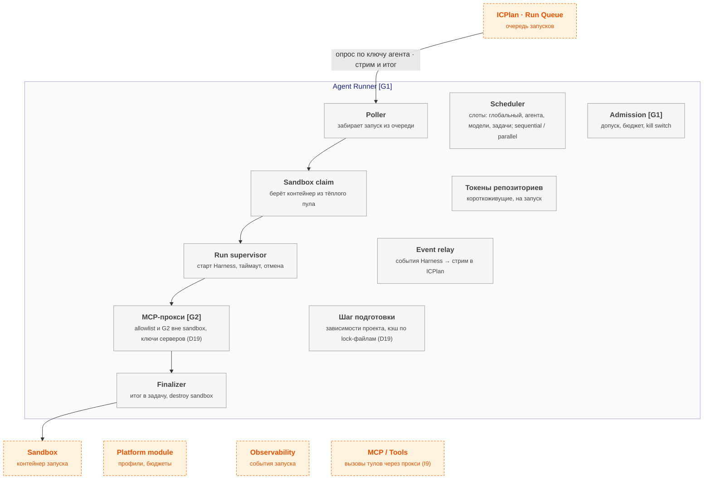

# agent-runner — схема

← [spec.md](spec.md)

Схема C3 по [FORMAT.md](../../../../../FORMAT.md). Цвет: зелёный — есть, жёлтый — частично, серый — не начато; оранжевый пунктир — соседний компонент.

## Схема

## Блоки

| Блок | Задача | Статус |
|---|---|---|
| Poller | забирает запуск из очереди | ⬜ не начато |
| Scheduler | слоты: глобальный, агента, модели, задачи; sequential / parallel | ⬜ не начато |
| Admission | допуск, бюджет, kill switch | ⬜ не начато |
| Sandbox claim | берёт контейнер из тёплого пула | ⬜ не начато |
| Токены репозиториев | короткоживущие, на запуск | ⬜ не начато |
| Run supervisor | старт Harness, таймаут, отмена | ⬜ не начато |
| Event relay | события Harness → стрим в ICPlan | ⬜ не начато |
| MCP-прокси | allowlist и G2 вне sandbox, ключи серверов (D19) | ⬜ не начато |
| Шаг подготовки | зависимости проекта, кэш по lock-файлам (D19) | ⬜ не начато |
| Finalizer | итог в задачу, destroy sandbox | ⬜ не начато |

## Настройка

Параметры модуля — [interfaces.md](interfaces.md) (раздел «Параметры модуля»); на сайте — вкладка «Deploy» компонента, раздел «Конфигурация».

## Плюсы / минусы

| ➕ | ➖ |
|---|---|
| Каждый запуск изолирован и под контролем лимитов и бюджета | Гонки слотов — конкурентный тест в 2.7. |
| Минимум доработок ICPlan: для него мы — обычный внешний раннер | Пересмотр: на этапе 4 (Kubernetes) — Kueue для ёмкости узлов поверх наших слотов модели. |
| Одна точка, где виден жизненный цикл запуска |  |

Обоснование: [R&D](../../../../../docs/rnd/runner-and-scheduling.md).
