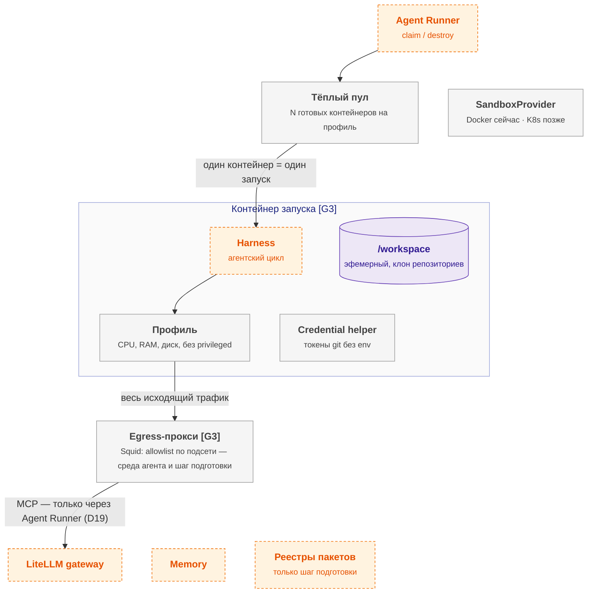

# agent-sandbox — схема

← [spec.md](spec.md)

Схема C3 по [FORMAT.md](../../../../../FORMAT.md). Цвет: зелёный — есть, жёлтый — частично, серый — не начато; оранжевый пунктир — соседний компонент.

## Схема

## Блоки

| Блок | Задача | Статус |
|---|---|---|
| Тёплый пул | N готовых контейнеров на профиль | ⬜ не начато |
| SandboxProvider | Docker сейчас · K8s позже | ⬜ не начато |
| /workspace | эфемерный, клон репозиториев | ⬜ не начато |
| Профиль | CPU, RAM, диск, без privileged | ⬜ не начато |
| Credential helper | токены git без env | ⬜ не начато |
| Egress-прокси | Squid: allowlist по подсети — среда агента и шаг подготовки | ⬜ не начато |

## Настройка

Параметры модуля — [interfaces.md](interfaces.md) (раздел «Параметры модуля»); на сайте — вкладка «Deploy» компонента, раздел «Конфигурация».

## Плюсы / минусы

| ➕ | ➖ |
|---|---|
| Сбой или атака в одном запуске не задевает другие и хост | Побег из контейнера через ядро — gVisor (проверка в 2.2), rootless, без привилегий. |
| Старт за доли секунды | Пересмотр: агенты запускают код из внешних источников → microVM (Kata, Firecracker), если KVM есть. |
| Секреты не попадают к агенту |  |

Обоснование: [R&D](../../../../../docs/rnd/sandbox-isolation.md).
