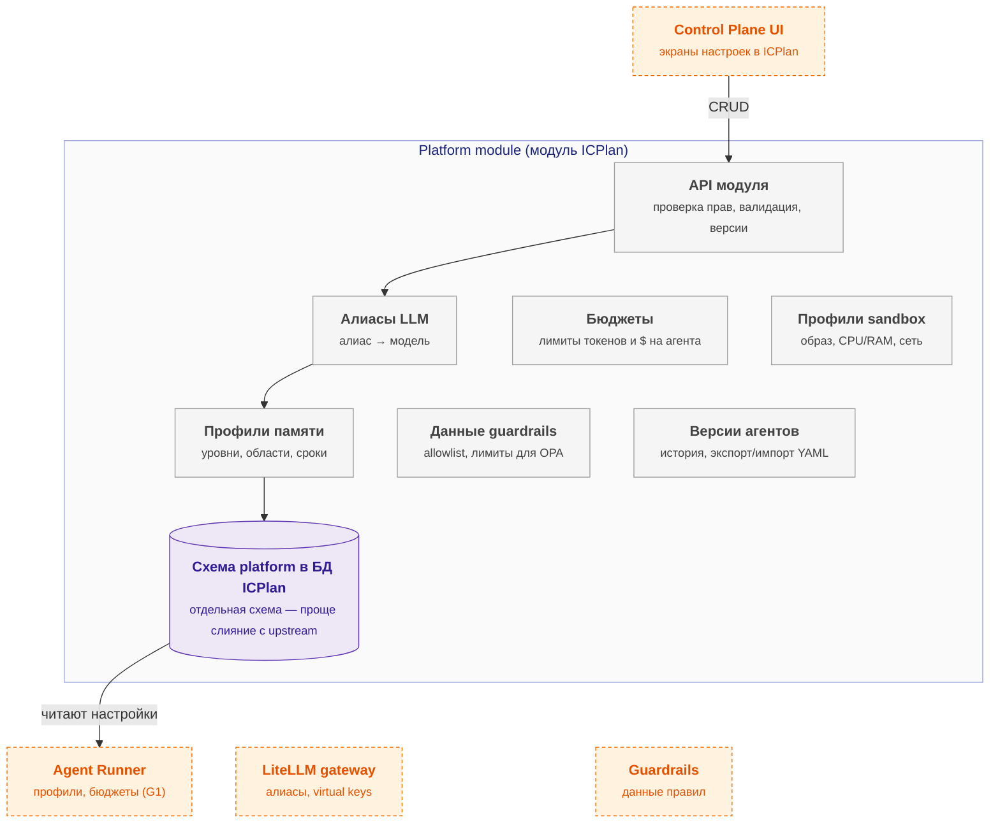

# control-plane — схема

← [spec.md](spec.md)

Схема C3 по [FORMAT.md](../../../../../FORMAT.md). Цвет: зелёный — есть, жёлтый — частично, серый — не начато; оранжевый пунктир — соседний компонент.

## Схема

## Блоки

| Блок | Задача | Статус |
|---|---|---|
| API модуля | проверка прав, валидация, версии | ⬜ не начато |
| Алиасы LLM | алиас → модель | ⬜ не начато |
| Бюджеты | лимиты токенов и $ на агента | ⬜ не начато |
| Профили sandbox | образ, CPU/RAM, сеть | ⬜ не начато |
| Профили памяти | уровни, области, сроки | ⬜ не начато |
| Данные guardrails | allowlist, лимиты для OPA | ⬜ не начато |
| Версии агентов | история, экспорт/импорт YAML | ⬜ не начато |
| Схема platform в БД ICPlan | отдельная схема — проще слияние с upstream | ⬜ не начато |

## Расширения и настройка

| Что настраивается | На что влияет |
|---|---|
| `model_alias` | Качество и цена: сильная модель — лучше результат, дороже |
| `fallback` | Агент работает при сбое провайдера |
| `budget.daily_usd` | Защита от перерасхода; при исчерпании запуски отклоняются (G1) |
| `budget.per_run_tokens` | Ограничивает «бесконечные» запуски |
| `rate_limit` | Сглаживает пики, защищает от лимитов провайдера |
| `limits.max_steps` | Больше — сложнее задачи, но дороже и риск зацикливания |
| `limits.timeout_s` | Длинные задачи против зависаний |
| `concurrency` | Пропускная способность против нагрузки и трат |

## Плюсы / минусы

| ➕ | ➖ |
|---|---|
| Одна БД, один UI, одна авторизация | Ошибочная правка в интерфейсе — версии и откат (R-REG-03), журнал изменений. |
| Все настройки агента в одном месте рядом с ним | Пересмотр: агентов начнут создавать разработчики в репозиториях чаще, чем администраторы в интерфейсе. |
| Каждый параметр меняет поведение агента без кода и деплоя |  |

Обоснование: [R&D](../../../../../docs/rnd/config-storage.md).
