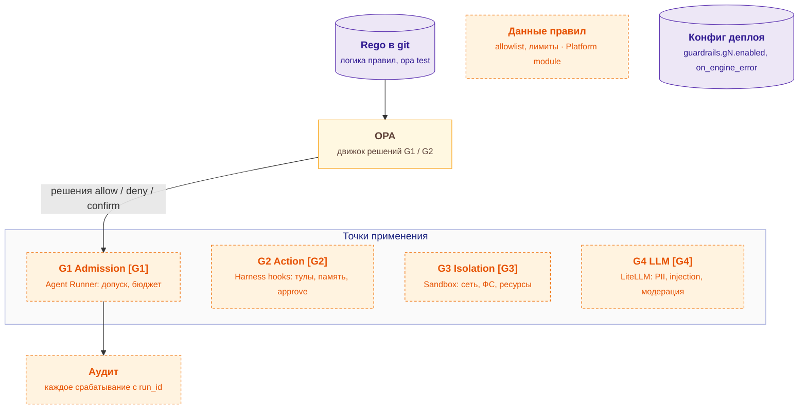

# guardrails — схема

← [spec.md](spec.md)

Схема C3 по [FORMAT.md](../../../../../FORMAT.md). Цвет: зелёный — есть, жёлтый — частично, серый — не начато; оранжевый пунктир — соседний компонент.

## Схема

## Блоки

| Блок | Задача | Статус |
|---|---|---|
| Rego в git | логика правил, opa test | ⬜ не начато |
| Конфиг деплоя | guardrails.gN.enabled, on_engine_error | ⬜ не начато |
| OPA | движок решений G1 / G2 | ⚠️ частично |

## Настройка

Параметры модуля — [interfaces.md](interfaces.md) (раздел «Параметры модуля»); на сайте — вкладка «Deploy» компонента, раздел «Конфигурация».

## Плюсы / минусы

| ➕ | ➖ |
|---|---|
| Безопасность настраивается и проверяется, а не размазана по коду | Rego сложнее читать — шаблоны правил и тесты на каждое. |
| Понятно, почему агенту отказали (аудит) | OPA недоступен — `on_engine_error: deny`. |
| Опасные действия ждут человека | Пересмотр: появится официальная Python-библиотека Cedar и правила станут чисто ролевыми. |

Обоснование: [R&D](../../../../../docs/rnd/guardrails-engine.md).
