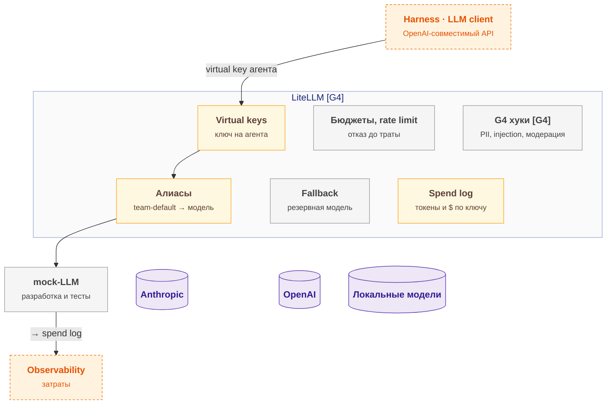

# llm-gateway — схема

← [spec.md](spec.md)

Схема C3 по [FORMAT.md](../../../../../FORMAT.md). Цвет: зелёный — есть, жёлтый — частично, серый — не начато; оранжевый пунктир — соседний компонент.

## Схема

## Блоки

| Блок | Задача | Статус |
|---|---|---|
| Virtual keys | ключ на агента | ⚠️ частично |
| Бюджеты, rate limit | отказ до траты | ⬜ не начато |
| G4 хуки | PII, injection, модерация | ⬜ не начато |
| Алиасы | team-default → модель | ⚠️ частично |
| Fallback | резервная модель | ⬜ не начато |
| Spend log | токены и $ по ключу | ⚠️ частично |
| mock-LLM | разработка и тесты | ⬜ не начато |
| Anthropic | — | — |
| OpenAI | — | — |
| Локальные модели | — | — |

## Расширения и настройка

| Что настраивается | На что влияет |
|---|---|
| `model_list` | Какая модель отвечает агенту |
| `fallbacks` | Устойчивость к сбоям |
| `key.max_budget` | Жёсткий стоп перерасхода |
| `key.rpm / tpm` | Защита от пиков |
| `guardrails (G4)` | Безопасность запросов против латентности |

## Плюсы / минусы

| ➕ | ➖ |
|---|---|
| Смена модели без изменения агентов | Производительность Python-шлюза — тест 4.8. |
| Контроль и учёт затрат по агенту и задаче | Платные функции LiteLLM (enterprise) — используем только ядро. |
| Mock-LLM для разработки без ключей | Пересмотр: накладные расходы > 50 мс p95 на профиле или нужная функция уйдёт в enterprise → Bifrost. |
| Работа при сбое провайдера |  |

Обоснование: [R&D](../../../../../docs/rnd/llm-gateway.md).
