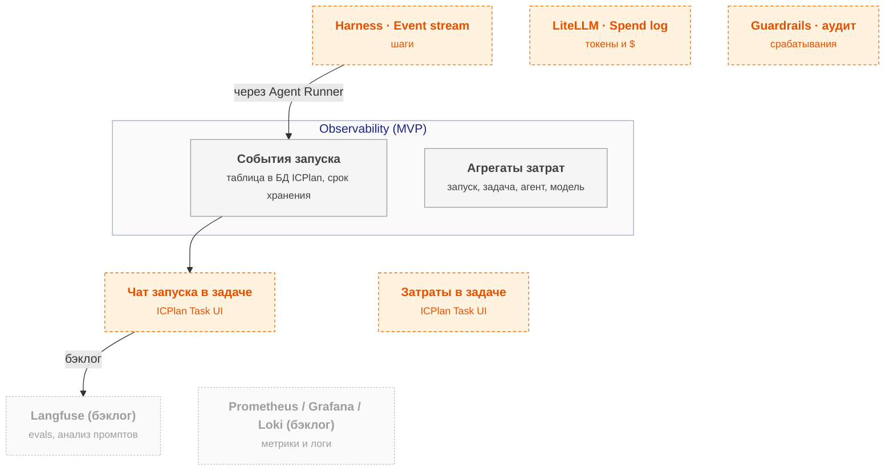

# observability — схема

← [spec.md](spec.md)

Схема C3 по [FORMAT.md](../../../../../FORMAT.md). Цвет: зелёный — есть, жёлтый — частично, серый — не начато; оранжевый пунктир — соседний компонент.

## Схема

## Блоки

| Блок | Задача | Статус |
|---|---|---|
| События запуска | таблица в БД ICPlan, срок хранения | ⬜ не начато |
| Агрегаты затрат | запуск, задача, агент, модель | ⬜ не начато |
| Langfuse | evals, анализ промптов | бэклог |
| Prometheus / Grafana / Loki | метрики и логи | бэклог |

## Расширения и настройка

| Что настраивается | На что влияет |
|---|---|
| `events.level` | Подробность чата запуска против объёма |
| `retention_days` | Глубина разбора против места |
| `cost.source` | Точность учёта |

## Плюсы / минусы

| ➕ | ➖ |
|---|---|
| Чат запуска работы агента в задаче | Объём событий при `events.level: всё` (решение владельца) — ~250 МБ/день; маскирование до записи, срок 90 дней. |
| Затраты по задаче и агенту | Соглашения OTel GenAI в статусе Development — версию фиксируем при экспорте. |
| Разбор отказов guardrails | Пересмотр: разработчикам нужен разбор промптов на каждом запуске → Langfuse или Phoenix. |

Обоснование: [R&D](../../../../../docs/rnd/observability.md).
