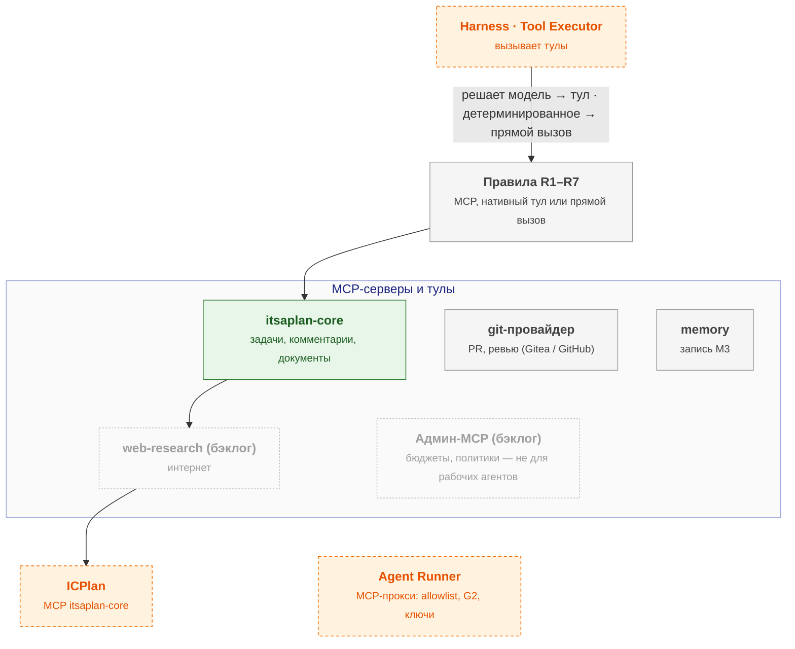

# tool-integration — схема

← [spec.md](spec.md)

Схема C3 по [FORMAT.md](../../../../../FORMAT.md). Цвет: зелёный — есть, жёлтый — частично, серый — не начато; оранжевый пунктир — соседний компонент.

## Схема

## Блоки

| Блок | Задача | Статус |
|---|---|---|
| Правила R1–R7 | MCP, нативный тул или прямой вызов | ⬜ не начато |
| itsaplan-core | задачи, комментарии, документы | ✅ есть |
| git-провайдер | PR, ревью (Gitea / GitHub) | ⬜ не начато |
| memory | запись M3 | ⬜ не начато |
| web-research | интернет | бэклог |
| Админ-MCP | бюджеты, политики — не для рабочих агентов | бэклог |

## Настройка

Параметры модуля — [interfaces.md](interfaces.md) (раздел «Параметры модуля»); на сайте — вкладка «Deploy» компонента, раздел «Конфигурация».

## Плюсы / минусы

| ➕ | ➖ |
|---|---|
| Новые действия агента без изменения кода | Runner на пути каждого вызова MCP — таймаут 30 с, отказ сервера — ошибка тула (FMEA Runner). |
| Внешние агенты (Claude Code и др.) используют те же тулы | Пересмотр: число тулов агента > 30 — включить поиск тулов. |
| Правила R1–R7 не дают тащить в MCP то, что быстрее прямым вызовом |  |

Обоснование: [R&D](../../../../../docs/rnd/mcp-vs-direct.md).
